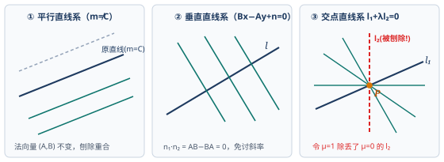

# 直线系方程全归纳：几何本质与「为什么必须刨除」

> **来源**：补充专题（直线系方程） ｜ **适用模块**：一、直线与方程

## 一、什么是直线系？

确定一条直线需要 **2 个独立条件**；只给定 **1 个独立条件**、留出 **1 个自由参数**的所有直线集合，称为**直线系**。用直线系设方程可以跳过求交点或求斜率的中间步骤，直接利用第二个条件解参数。

## 二、四大常见直线系方程（公式、原理与刨除说明）

### 1. 平行直线系
- **斜截式**：与斜率为 $k$ 的直线平行 $\Rightarrow y = kx + b$（$k$ 为定值，$b$ 为参数）。
- **一般式**：与直线 $Ax + By + C = 0$ 平行 $\Rightarrow Ax + By + m = 0$（$m$ 为参数，且 **$m \neq C$**）。
- **过定点平行**：过点 $P(x_0, y_0)$ 且平行于 $Ax + By + C = 0$ $\Rightarrow A(x - x_0) + B(y - y_0) = 0$（前提：$Ax_0 + By_0 + C \neq 0$）。
- **为什么代表平行？为什么要刨除 $m = C$？**
    - 法向量 $\vec{n} = (A, B)$ 保持不变，故所有直线方向完全一致；改变常数项 $m$ 仅相当于沿法线方向平移。
    - 当 $m = C$ 时方程与原直线完全相同，属于**重合**而非平行，因此必须刨除 $m = C$。

### 2. 垂直直线系
- **斜截式**：与 $y = kx + b\ (k \neq 0)$ 垂直 $\Rightarrow y = -\frac{1}{k}x + m$（$m$ 为参数）。
- **一般式（推荐，免讨论斜率不存在）**：与 $Ax + By + C = 0$ 垂直 $\Rightarrow Bx - Ay + n = 0$（$n$ 为参数）。
- **过定点垂直**：过点 $P(x_0, y_0)$ 且垂直于 $Ax + By + C = 0$ $\Rightarrow B(x - x_0) - A(y - y_0) = 0$。
- **为什么这样写就一定垂直？**
    - 原直线法向量 $\vec{n}_1 = (A, B)$，新直线法向量 $\vec{n}_2 = (B, -A)$，两者数量积为 $\vec{n}_1 \cdot \vec{n}_2 = AB - BA = 0$，即两法向量恒垂直 $\Rightarrow$ 两直线恒垂直！且无论 $A = 0$ 还是 $B = 0$ 均成立，**不需要刨除任何直线**。

### 3. 中心直线系（过定点 $P(x_0, y_0)$ 的直线）
- **点斜式**：$y - y_0 = k(x - x_0)$（**刨除了竖直线 $x = x_0$**）。
- **斜截式**：$y = kx + b$（$b$ 定、$k$ 参，过定点 $(0, b)$，**刨除了 $y$ 轴 $x = 0$**）。
- **横截距式**：$x = my + a$（$a$ 定、$m$ 参，过定点 $(a, 0)$，**刨除了水平线 $y = 0$**）。
- **完全形式（不漏线）**：$A(x - x_0) + B(y - y_0) = 0$（$A$、$B$ 不全为 $0$，**不刨除任何直线**）。
- **为什么点斜式、斜截式、横截距式都会各漏一条线？**
    - 在 $y - y_0 = k(x - x_0)$ 中，$(y - y_0)$ 前的系数被写死为 $1$，无论有限实数 $k$ 取何值都无法消去 $y$，故永远写不出竖直线 $x - x_0 = 0$；
    - 同理，在 $x = my + a$ 中，$x$ 的系数被写死为 $1$，永远无法消去 $x$，故永远写不出水平线 $y = 0$。

### 4. 过两条相交直线交点的直线系（核心重点）
设直线 $l_1: A_1 x + B_1 y + C_1 = 0$ 与 $l_2: A_2 x + B_2 y + C_2 = 0$ 相交于点 $P(x_0, y_0)$，则过其交点的直线系方程为：

$$A_1 x + B_1 y + C_1 + \lambda (A_2 x + B_2 y + C_2) = 0 \quad (\lambda \in R,\; \text{不含直线 } l_2)$$

#### （1）为什么这个方程一定表示「过交点 $P$ 的直线」？（两步证明）
- **第一步：为什么对任意 $\lambda \in R$ 都是一条直线？**
    - 合并同类项得 $(A_1 + \lambda A_2)x + (B_1 + \lambda B_2)y + (C_1 + \lambda C_2) = 0$，是二元一次方程。
    - 因 $l_1$ 与 $l_2$ 相交不平行（$A_1 B_2 - A_2 B_1 \neq 0$），两法向量 $(A_1, B_1)$ 与 $(A_2, B_2)$ 不共线，故 $A_1 + \lambda A_2$ 与 $B_1 + \lambda B_2$ **不可能同时为 $0$**，因此对任意实数 $\lambda$ 均表示一条有效直线。
- **第二步：为什么必然经过交点 $P(x_0, y_0)$？**
    - 因 $P(x_0, y_0)$ 同时在 $l_1$ 和 $l_2$ 上，代入满足 $A_1 x_0 + B_1 y_0 + C_1 = 0$ 且 $A_2 x_0 + B_2 y_0 + C_2 = 0$，故左式恒为 $0 + \lambda \cdot 0 = 0$，直线必过点 $P$。

#### （2）核心追问：为什么要刨除直线 $l_2$？
过交点 $P$ 的**完整双参数方程**其实是：

$$\mu (A_1 x + B_1 y + C_1) + \lambda (A_2 x + B_2 y + C_2) = 0 \quad (\mu,\; \lambda \text{ 不全为 } 0)$$

- 当 $\lambda = 0$、$\mu \neq 0$ 时，方程化为 $l_1$；
- 当 $\mu = 0$、$\lambda \neq 0$ 时，方程化为 $l_2$。
- **刨除的本质原因**：为了把两个参数简化成一个参数，我们两边同除以 $\mu$（即令 $\mu = 1$），这一步**强行默认了 $\mu \neq 0$**，于是把唯一对应 $\mu = 0$ 的直线 $l_2$ 给「除丢」了！从代数上看，$l_1$ 前的系数被锁死为 $1$，任何有限实数 $\lambda$ 都消不掉 $l_1$（除非 $\lambda \to \infty$），因此永远无法表示 $l_2$。
- **大一统视角**：点斜式 $y - y_0 - k(x - x_0) = 0$ 本质上就是 $l_1: y - y_0 = 0$ 与 $l_2: x - x_0 = 0$ 的交点直线系（取 $\lambda = -k$），所以它才天然刨除了 $l_2: x = x_0$！

## 三、附：直线方程的平移变换规律
对于直线 $y = kx + b$（$m > 0$）：

- **上下平移（沿 $y$ 轴）**：$y = kx + b \pm m$（**上加下减**）；
- **左右平移（沿 $x$ 轴）**：$y = k(x \pm m) + b$（**左加右减**）。
