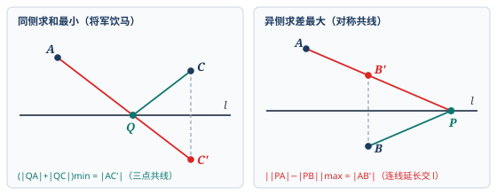

# 直线过定点、对称最值与三角形综合问题（含例 29）

> **专题**：直线综合 ｜ **适用模块**：一、直线与方程

## 一、求直线过定点的四种通法

1. **直接法**：将含参直线方程直接化为点斜式、斜截式或截距式，直接读出定点。
2. **方程法（主元分离法）**：将方程整理为关于参数 $a$ 的恒等式 $f(x, y) + a \cdot g(x, y) = 0$，令：

$$\begin{cases} f(x, y) = 0 \\ g(x, y) = 0 \end{cases}$$

解出 $(x, y)$ 即为所有直线恒过的定点坐标。

- **3. 特殊值法**：给参数赋予两个方便计算的特殊值，联立所得两条具体直线求交点，再代回原方程验证即可。
- **4. 直线系法**：整理为 $A_1 x + B_1 y + C_1 + \lambda (A_2 x + B_2 y + C_2) = 0$，转化为求两定直线 $A_1 x + B_1 y + C_1 = 0$ 与 $A_2 x + B_2 y + C_2 = 0$ 的交点。

## 二、利用对称求直线上动点的距离和/差最值

- **同侧求和最小（将军饮马）**：两点 $A$、$C$ 在直线 $l$ 同侧，求 $l$ 上点 $Q$ 使 $|QA| + |QC|$ 最小。作 $C$ 关于 $l$ 的对称点 $C'$，连 $AC'$ 交 $l$ 于 $Q$，由三角形两边之和大于第三边得 $(|QA| + |QC|)_{\min} = |AC'|$。
- **异侧求差最大**：两点 $A$、$B$ 在直线 $l$ 两侧，求 $l$ 上点 $P$ 使 $||PA| - |PB||$ 最大。作 $B$ 关于 $l$ 的对称点 $B'$，连 $AB'$ 并延长交 $l$ 于 $P$，由三角形两边之差小于第三边得 $||PA| - |PB||_{\max} = |AB'|$。
- **光线反射问题**：入射光线与反射光线关于法线对称，入射光线上点的对称点落在反射光线所在直线上，转化为两点式求解。

## 三、与三角形、四边形有关的综合问题（经典例 29）

**例 29**：已知点 $A(2, 1)$，$B(3, 4)$，$C(-2, -1)$。
- (1) 求 $\triangle ABC$ 的面积；
- (2) 求 $\angle ABC$ 的平分线所在直线的方程。

### (1) 求 $\triangle ABC$ 面积（两种思路与解法）

- **思路一（底 $\times$ 高：两点间距 + 点到直线距离）**：
    - $|AB| = \sqrt{(3 - 2)^2 + (4 - 1)^2} = \sqrt{10}$；
    - 由两点式得直线 $AB$ 方程为 $\frac{y - 1}{4 - 1} = \frac{x - 2}{3 - 2}$，即 $3x - y - 5 = 0$；
    - 点 $C(-2, -1)$ 到直线 $AB$ 的距离（即 $AB$ 边上的高）为：

$$h = \frac{|3 \times (-2) - (-1) - 5|}{\sqrt{3^2 + (-1)^2}} = \frac{10}{\sqrt{10}} = \sqrt{10}$$

- 故 $S_{\triangle ABC} = \frac{1}{2} \times |AB| \times h = \frac{1}{2} \times \sqrt{10} \times \sqrt{10} = 5$。
- **思路二（向量坐标面积公式，选填极快）**：
    - 求出 $\overrightarrow{BA} = (-1, -3)$、$\overrightarrow{BC} = (-5, -5)$，直接套用三角形面积向量坐标公式：

$$S_{\triangle ABC} = \frac{1}{2} |x_1 y_2 - x_2 y_1| = \frac{1}{2} |(-1)\times(-5) - (-3)\times(-5)| = \frac{1}{2} |5 - 15| = 5$$

### (2) 求 $\angle ABC$ 的平分线所在直线方程（两种思路与解法）

- **思路一（角平分线性质：到两边距离相等 + 数形结合检验）**：
    - 由 (1) 知 $AB: 3x - y - 5 = 0$；同理求得 $BC: y - 4 = \frac{4 - (-1)}{3 - (-2)}(x - 3)$，即 $x - y + 1 = 0$；
    - 设角平分线上任一点为 $M(x, y)$，因 $M$ 到边 $BC$、$BA$ 的距离相等：

$$\frac{|3x - y - 5|}{\sqrt{10}} = \frac{|x - y + 1|}{\sqrt{2}} \Rightarrow |3x - y - 5| = \sqrt{5}|x - y + 1|$$

- 去绝对值整理得两解：$(3 - \sqrt{5})x + (\sqrt{5} - 1)y - 5 - \sqrt{5} = 0$（外角平分线）或 $(3 + \sqrt{5})x - (1 + \sqrt{5})y + \sqrt{5} - 5 = 0$（内角平分线）；
- 数形结合知 $\angle ABC$ 内角平分线斜率应为正，故所求方程为 **$(3 + \sqrt{5})x - (1 + \sqrt{5})y + \sqrt{5} - 5 = 0$**。
- **思路二（方向向量夹角余弦相等法）**：
    - 由 $k_{AB} = 3$、$k_{BC} = 1$，取 $AB$、$BC$ 的方向向量 $v_{AB} = (1, 3)$、$v_{BC} = (1, 1)$；设角平分线斜率为 $k\ (1 < k < 3)$，其方向向量 $v = (1, k)$；
    - 因角平分线平分 $\angle ABC$，故两夹角余弦绝对值相等 $|\cos\langle v_{AB}, v\rangle| = |\cos\langle v_{BC}, v\rangle|$：

$$\frac{|1 + 3k|}{\sqrt{10}\sqrt{1 + k^2}} = \frac{|1 + k|}{\sqrt{2}\sqrt{1 + k^2}} \Rightarrow |1 + 3k| = \sqrt{5}|1 + k|$$

- 解得 $k = \frac{1 - \sqrt{5}}{2}$（舍，不在 $(1, 3)$ 内）或 $k = \frac{1 + \sqrt{5}}{2}$；
- 又过点 $B(3, 4)$，由点斜式 $y - 4 = \frac{1 + \sqrt{5}}{2}(x - 3)$ 整理得 **$(\sqrt{5} + 1)x - 2y + 5 - 3\sqrt{5} = 0$**（与方法一等价）。
