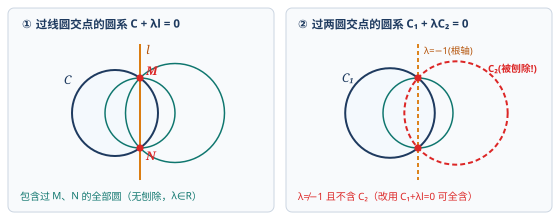

# 圆系方程全归纳：几何本质与「为什么必须刨除」

> **来源**：补充专题（圆系方程） ｜ **适用模块**：二、圆与方程

## 一、什么是圆系？

确定一个圆需要 **3 个独立条件**；只给定 **2 个独立条件**、留出 **1 个自由参数**的所有圆的集合，称为**圆系**。

## 二、四大常见圆系方程（公式、原理与刨除说明）

### 1. 同心圆系方程
$$(x - a)^2 + (y - b)^2 = r^2 \quad (a,\; b \text{ 为定值},\; r > 0 \text{ 为参数})$$

- **几何含义**：圆心 $(a, b)$ 固定，半径 $r$ 自由伸缩的所有同心圆。

### 2. 等半径圆系方程
$$(x - a)^2 + (y - b)^2 = r^2 \quad (a,\; b \text{ 为参数},\; r > 0 \text{ 为定值})$$

- **几何含义**：半径固定为 $r$、圆心在平面内自由平移的所有等圆。

### 3. 过直线与圆交点的圆系方程（无遗漏！）
设圆 $C: x^2 + y^2 + Dx + Ey + F = 0$ 与直线 $l: Ax + By + C_0 = 0$ 相交于 $M$、$N$ 两点，则过 $M$、$N$ 的圆系方程为：

$$x^2 + y^2 + Dx + Ey + F + \lambda(Ax + By + C_0) = 0 \quad (\lambda \in R)$$

- **为什么对任意 $\lambda \in R$ 都是过交点 $M$、$N$ 的圆？**
    1. 展开为 $x^2 + y^2 + (D + \lambda A)x + (E + \lambda B)y + (F + \lambda C_0) = 0$，二次项 $x^2$ 与 $y^2$ 系数恒为 $1$ 且无 $xy$ 项；
    2. 交点 $M$、$N$ 同时满足圆方程 $= 0$ 和直线方程 $= 0$，故代入恒为 $0 + \lambda \cdot 0 = 0$；
    3. 因方程至少有两个不同的实数解 $M$、$N$，故它不可能退化为点或无解（$D'^2 + E'^2 - 4F' > 0$ 自动成立！）。
- **是否刨除了某个圆？**
    - **没有刨除任何圆！** 取 $\lambda = 0$ 即得原圆 $C$，遍历 $\lambda \in R$ 可覆盖过 $M$、$N$ 的**全部圆**（被除丢的 $\mu = 0$ 对应直线 $l$ 本身，而 $l$ 不是圆，所以圆一个都没少！）。

### 4. 过两圆交点的圆系方程（核心重点）
设圆 $C_1: x^2 + y^2 + D_1 x + E_1 y + F_1 = 0$ 与圆 $C_2: x^2 + y^2 + D_2 x + E_2 y + F_2 = 0$ 相交于 $M$、$N$，则过两圆交点的圆系方程为：

$$x^2 + y^2 + D_1 x + E_1 y + F_1 + \lambda(x^2 + y^2 + D_2 x + E_2 y + F_2) = 0 \quad (\lambda \neq -1,\; \text{不含圆 } C_2)$$

#### （1）为什么它是过两交点的圆？
合并同类项得：

$$(1 + \lambda)x^2 + (1 + \lambda)y^2 + (D_1 + \lambda D_2)x + (E_1 + \lambda E_2)y + (F_1 + \lambda F_2) = 0$$

只要 $1 + \lambda \neq 0$，就有 $x^2$ 与 $y^2$ 系数相等且非零、无 $xy$ 项，且两交点 $M$、$N$ 代入满足 $0 + \lambda \cdot 0 = 0$，因此必为过 $M$、$N$ 的圆。

#### （2）核心追问 1：为什么要刨除圆 $C_2$？
- 与「交点直线系刨除 $l_2$」**完全同源**！
- 完整双参数形式为 $\mu C_1 + \lambda C_2 = 0$（$\mu + \lambda \neq 0$）。当 $\mu = 0$、$\lambda \neq 0$ 时得到圆 $C_2$；但为缩减参数令 $\mu = 1$（两边除以 $\mu$），就强行排除了 $\mu = 0$ 的情形，从而永远消不掉前面系数为 $1$ 的 $C_1$，也就永远无法表示圆 $C_2$。
- **解题避坑**：用此圆系求圆方程时，若遇到无解或需验证边界，务必单独检验圆 $C_2$ 本身是否满足题目条件。

#### （3）核心追问 2：为什么要规定 $\lambda \neq -1$？当 $\lambda = -1$ 时变成了什么？
- 当 $\lambda = -1$ 时，二次项系数 $1 + \lambda = 0$，$x^2$ 与 $y^2$ 项被彻底抵消，方程降次为二元一次方程：

$$(D_1 - D_2)x + (E_1 - E_2)y + (F_1 - F_2) = 0$$

- 此时它**不再是圆，而是直线**——正是前面「两圆方程相减的几何意义」所讲的**根轴（等幂轴）**：
    - 两圆相交时，为公共弦所在直线；
    - 两圆相切时，为过切点的公切线；
    - 两圆外离或内含时，为垂直于连心线的等幂轴（直线上任一点到两圆切线长相等；同心圆除外）。

## 三、实战神技：如何改写才能「既不刨除 $C_2$，又免去分母 $1 + \lambda$」？

直接用 $C_1 + \lambda C_2 = 0$ 时，圆心坐标为 $\left(-\frac{D_1 + \lambda D_2}{2(1 + \lambda)},\; -\frac{E_1 + \lambda E_2}{2(1 + \lambda)}\right)$，带分母较麻烦，还会漏掉 $C_2$。

**更优改写法**：先将两圆相减求出公共弦直线 $l: (D_1 - D_2)x + (E_1 - E_2)y + (F_1 - F_2) = 0$，再套用「线圆交点圆系」：

$$C_1 + \lambda l = 0 \quad (\lambda \in R)$$

- **两大优势**：
    1. 二次项系数恒为 $1$，**圆心坐标没有分母 $1 + \lambda$**，计算量减半；
    2. **一个圆都不刨除**：$\lambda = 0$ 就是圆 $C_1$，$\lambda = -1$ 时 $C_1 - (C_1 - C_2) = C_2$ 就是圆 $C_2$，真正覆盖过两交点的全部圆！
