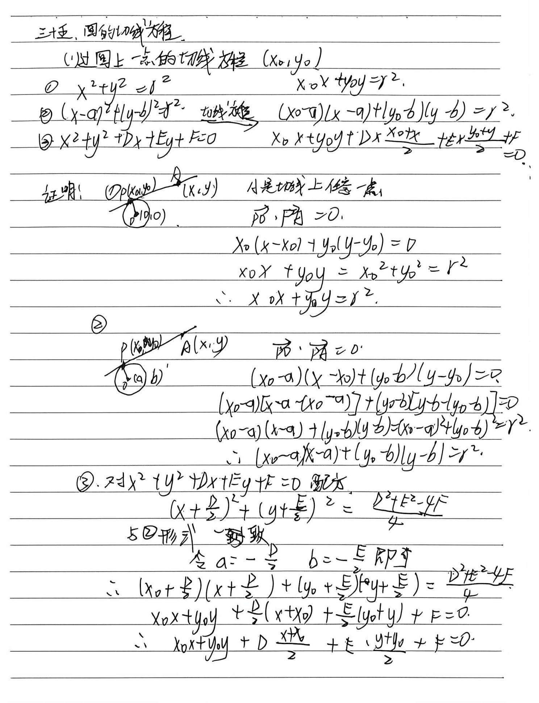
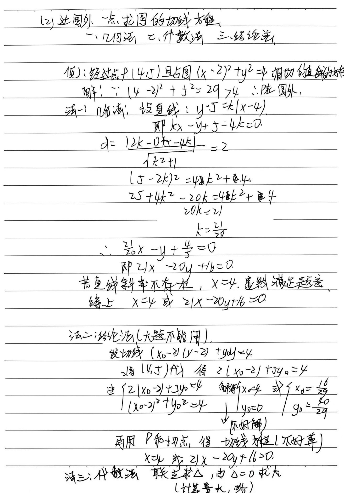

# 圆的切线方程（含斜率已知求切线）

> **原序号**：大写 三十五、

**补充通法（已知斜率为 $k$ 且与圆相切的切线方程，一般有两条）**：

- **法一（几何法，优先）**：设切线为 $y = kx + m$（即 $kx - y + m = 0$），利用圆心到直线距离 $d = r$ 解出 $m$；
- **法二（代数法）**：联立直线与圆方程消元，令判别式 $\Delta = 0$ 解出 $m$。

