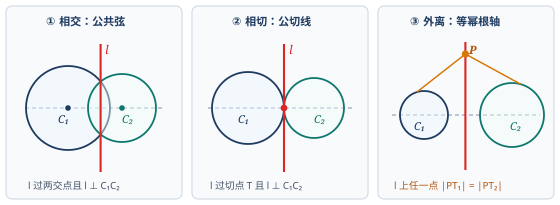

# 两圆方程相减究竟得到什么？（根轴 / 等幂轴完整证明）

> **来源**：补充专题（接续「原：大写 三十四、两圆公共弦、公切线直线方程」） ｜ **适用模块**：二、圆与方程

## 一、核心结论：两圆方程相减得到的直线统一称为「根轴（等幂轴）」

设两圆方程（二次项系数均已化为 $1$，且非同心圆）分别为：

$$\begin{cases} C_1: x^2 + y^2 + D_1 x + E_1 y + F_1 = 0 \\ C_2: x^2 + y^2 + D_2 x + E_2 y + F_2 = 0 \end{cases}$$

两式相减消去二次项，得到一条直线 $l$：

$$(D_1 - D_2)x + (E_1 - E_2)y + (F_1 - F_2) = 0$$

随着两圆位置关系不同，这条直线 $l$ 具有完全统一的几何意义：

| 两圆位置关系 | 相减所得直线 $l$ 的几何意义 | 关键特征 |
| --- | --- | --- |
| **两圆相交** | **公共弦**所在直线 | 经过两圆的两个交点 $A$、$B$，且 $l \perp C_1 C_2$。 |
| **两圆相切（外切或内切）** | 过切点的**公切线** | 外切时为内公切线，内切时为外公切线，且 $l \perp C_1 C_2$。 |
| **两圆相离（外离或内含）** | **等幂轴（根轴）** | 直线 $l$ 与两圆均无交点，但仍垂直于连心线 $C_1 C_2$；外离时 $l$ 位于两圆之间，且 **$l$ 上任意一点向两圆所作的切线长相等**。 |

*(注：若两圆为同心圆，则 $D_1 = D_2$ 且 $E_1 = E_2$，相减得 $F_1 - F_2 = 0$ 矛盾，此时不存在根轴。)*

## 二、两条核心性质的完整证明

### 1. 证明：相减所得直线 $l$ 恒垂直于连心线 $C_1 C_2$
- 圆 $C_1$ 圆心为 $\left(-\frac{D_1}{2},\; -\frac{E_1}{2}\right)$，圆 $C_2$ 圆心为 $\left(-\frac{D_2}{2},\; -\frac{E_2}{2}\right)$，故连心线方向向量为：

$$\overrightarrow{C_1 C_2} = \left(\frac{D_1 - D_2}{2},\; \frac{E_1 - E_2}{2}\right) = \frac{1}{2}(D_1 - D_2,\; E_1 - E_2)$$

- 而直线 $l: (D_1 - D_2)x + (E_1 - E_2)y + (F_1 - F_2) = 0$ 的法向量恰为 $\vec{n} = (D_1 - D_2,\; E_1 - E_2)$；
- 因 $\vec{n} \parallel \overrightarrow{C_1 C_2}$，故无论两圆相交、相切还是相离，必有 **$l \perp C_1 C_2$**！

### 2. 证明：根轴 $l$ 上任意圆外点到两圆的切线长相等（等幂性）
- 任取直线 $l$ 上一点 $P(x_0, y_0)$，因 $P$ 满足 $(D_1 - D_2)x_0 + (E_1 - E_2)y_0 + (F_1 - F_2) = 0$，移项并在两边同加 $x_0^2 + y_0^2$ 得：

$$x_0^2 + y_0^2 + D_1 x_0 + E_1 y_0 + F_1 = x_0^2 + y_0^2 + D_2 x_0 + E_2 y_0 + F_2$$

- 由前面「切线长公式」（原：小写 44、｜P46），当 $P$ 在两圆外部时，左式恰为 $P$ 到圆 $C_1$ 的切线长平方 $|PT_1|^2$，右式恰为 $P$ 到圆 $C_2$ 的切线长平方 $|PT_2|^2$！
- 故 **$|PT_1|^2 = |PT_2|^2 \Rightarrow |PT_1| = |PT_2|$**！
- **反推三种情形**：
    - 当两圆相交于 $A$、$B$ 时，$A$、$B$ 到两圆的幂均为 $0$（相等），故 $A$、$B$ 必在根轴 $l$ 上，$l$ 即公共弦；
    - 当两圆相切于 $T$ 时，$T$ 到两圆的幂均为 $0$ 且 $l \perp C_1 C_2$，故 $l$ 即过切点 $T$ 的公切线；
    - 当两圆外离时，根轴 $l$ 上每个点到两圆的切线长都相等，且直线 $l$ 垂直于连心线 $C_1 C_2$（位于两圆之间，且更靠近半径较小的圆）。
