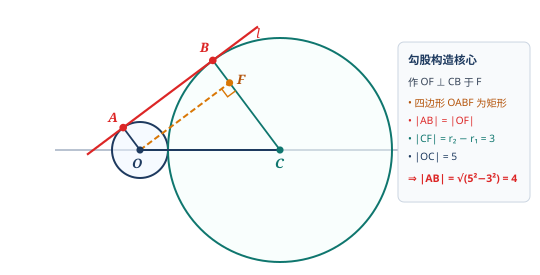

# 两圆公切线长、公共弦长与两圆相离最值（含例 13）

> **来源**：补充专题（两圆综合） ｜ **适用模块**：二、圆与方程

## 一、两圆公切线条数与公共弦长

- **公切线条数判定**：先判两圆位置关系——**外离 4 条**（2 外 2 内）、**外切 3 条**（2 外 1 内）、**相交 2 条**（2 外）、**内切 1 条**（1 外）、**内含 0 条**。
- **求两圆公共弦长的两种方法**：
    1. **几何法（优先）**：两圆方程相减求出公共弦所在直线方程，再利用其中一个圆的半径 $r$、圆心到公共弦距离 $d$，由垂径定理得弦长 $L = 2\sqrt{r^2 - d^2}$；
    2. **代数法**：联立两圆方程求出两交点坐标，用两点间距离公式求解。

## 二、求两圆的「公切线长」（两切点间距离，含例 13）

**通用步骤与公式**：设两圆圆心距为 $d = |O_1 O_2|$，半径为 $r_1$、$r_2$。
1. 判断两圆位置关系，画出草图；
2. 作出公切线，连接切点与两圆心（出现两个直角）；
3. 过小圆圆心作大圆半径（或延长线）的垂线，构造直角三角形用勾股定理：

$$\begin{cases} L_{\text{外公切线}} = \sqrt{|O_1 O_2|^2 - (r_1 - r_2)^2} \\ L_{\text{内公切线}} = \sqrt{|O_1 O_2|^2 - (r_1 + r_2)^2} \end{cases}$$

**例 13（外公切线长经典例题）**：已知 $\odot O: x^2 + y^2 = 1$ 与 $\odot C: (x - 5)^2 + y^2 = 16$，若直线 $l$ 与 $\odot O$、$\odot C$ 分别切于相异的 $A$、$B$ 两点，求 $|AB|$。

- **解析**：
    - $\odot O$ 圆心 $O(0, 0)$，半径 $r_1 = 1$；$\odot C$ 圆心 $C(5, 0)$，半径 $r_2 = 4$。
    - 因 $|OC| = 5 = r_1 + r_2$，故两圆**外切**；当直线 $l$ 斜率不存在时为内公切线，两切点重合不合题意，故 $l$ 为外公切线。
    - 连接 $OA$、$CB$，过 $O$ 作 $OF \perp CB$，垂足为 $F$，则四边形 $OABF$ 为矩形，故 $|OA| = |BF| = 1$，$|CF| = |CB| - |BF| = 4 - 1 = 3$。
    - 在 $\text{Rt}\triangle OCF$ 中，$|OC| = 5$，由勾股定理得：

$$|AB| = |OF| = \sqrt{|OC|^2 - |CF|^2} = \sqrt{5^2 - 3^2} = 4$$

## 三、两圆相离时的动点距离最值

设圆 $O_1$、$O_2$ 半径分别为 $r_1$、$r_2$（不妨设 $r_1 \ge r_2$），$P$、$Q$ 分别为两圆上动点：

- **两圆外离**：$|PQ|_{\max} = |O_1 O_2| + r_1 + r_2$，$|PQ|_{\min} = |O_1 O_2| - r_1 - r_2$；
- **两圆内含**：$|PQ|_{\max} = |O_1 O_2| + r_1 + r_2$，$|PQ|_{\min} = r_1 - r_2 - |O_1 O_2|$。
