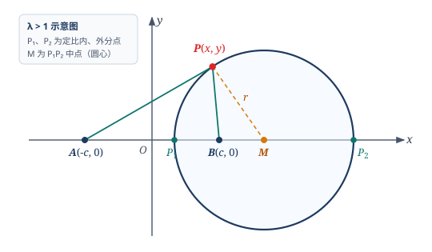

# 阿氏圆的定义、代数方程与快速作图

> **来源**：补充专题（阿氏圆 1/3） ｜ **适用模块**：二、圆与方程

## 一、定义与空间推广

- **定义（圆的第二定义）**：平面内给定两个相异定点 $A$、$B$，若动点 $P$ 满足：

$$\frac{|PA|}{|PB|} = \lambda \quad (\lambda > 0 \text{ 且 } \lambda \neq 1)$$

则点 $P$ 的轨迹是一个圆，称为**阿波罗尼斯圆（简称阿氏圆）**。

- **退化情形**：当 $\lambda = 1$ 时，$|PA| = |PB|$，点 $P$ 的轨迹为线段 $AB$ 的**垂直平分线**。
- **空间推广**：空间内到两定点的距离之比为常数 $\lambda\ (\lambda > 0 \text{ 且 } \lambda \neq 1)$ 的点的轨迹是一个**球面**。

## 二、代数方程推导

### 1. 标准建系形式（以 $AB$ 为 $x$ 轴、中垂线为 $y$ 轴）
设 $|AB| = 2c$，$A(-c, 0)$、$B(c, 0)$，动点 $P(x, y)$，由 $\frac{\sqrt{(x+c)^2 + y^2}}{\sqrt{(x-c)^2 + y^2}} = \lambda$ 平方化简得：

$$(1 - \lambda^2)x^2 + 2(1 + \lambda^2)cx + (1 - \lambda^2)c^2 + (1 - \lambda^2)y^2 = 0$$

- 当 $\lambda = 1$ 时，方程化为 $x = 0$（即 $AB$ 的中垂线）；
- 当 $\lambda \neq 1$ 时，两边同除以 $1 - \lambda^2$ 并配方得标准方程：

$$\left(x - \frac{\lambda^2 + 1}{\lambda^2 - 1}c\right)^2 + y^2 = \left(\frac{2\lambda c}{\lambda^2 - 1}\right)^2$$

由此直接读出圆心与半径：

$$\begin{cases} M = \left(\frac{\lambda^2 + 1}{\lambda^2 - 1}c,\; 0\right) \\ r = \left|\frac{2\lambda c}{\lambda^2 - 1}\right| = \left|\frac{|AB|}{\lambda - \frac{1}{\lambda}}\right| \end{cases}$$

### 2. 一般坐标形式
若 $A(x_1, y_1)$、$B(x_2, y_2)$，动点 $P(x, y)$ 满足 $\frac{|PA|}{|PB|} = k\ (k > 0 \text{ 且 } k \neq 1)$，则阿氏圆标准方程为：

$$\left(x + \frac{k^2 x_2 - x_1}{1 - k^2}\right)^2 + \left(y + \frac{k^2 y_2 - y_1}{1 - k^2}\right)^2 = \left(\frac{k}{1 - k^2}|AB|\right)^2$$

圆心必在直线 $AB$ 上，圆心坐标与半径为：

$$\begin{cases} M = \left(\frac{x_1 - k^2 x_2}{1 - k^2},\; \frac{y_1 - k^2 y_2}{1 - k^2}\right) \\ r = \left|\frac{k}{1 - k^2}\right| \cdot |AB| \end{cases}$$

## 三、快速找阿氏圆三步法（完整实操版）

做小题时无需设点平方展开，直接利用**直径两端点（内分点与外分点）**三步定位：

**Step 1：画直线、标定点、判偏向**

- 画出直线 $AB$ 并标出两定点 $A(x_1, y_1)$、$B(x_2, y_2)$。
- 先看比值 $\lambda = \frac{|PA|}{|PB|}$ 判断圆套住哪一个点：若 $\lambda > 1$，$|PA| > |PB|$，圆偏向 **$B$ 侧**（$B$ 在圆内、$A$ 在圆外）；若 $0 < \lambda < 1$，圆偏向 **$A$ 侧**（$A$ 在圆内、$B$ 在圆外）。

**Step 2：求直线 $AB$ 上的内分点 $P_1$ 与外分点 $P_2$**

- 在直线 $AB$ 上找满足 $\frac{|P_1 A|}{|P_1 B|} = \frac{|P_2 A|}{|P_2 B|} = \lambda$ 的两点：
    - **内分点 $P_1$**：落在线段 $AB$ 内部，把 $AB$ 按 $\lambda : 1$ 内分（$\overrightarrow{AP_1} = \lambda \overrightarrow{P_1 B}$）；
    - **外分点 $P_2$**：落在**更靠近圆内那一点**的外侧延长线上（$\lambda > 1$ 在 $AB$ 延长线上，$0 < \lambda < 1$ 在 $BA$ 延长线上，满足 $\overrightarrow{AP_2} = -\lambda \overrightarrow{P_2 B}$）。
- **定比分点坐标公式**（通用，若 $A$、$B$ 在坐标轴上直接按份数口算更快）：

$$\begin{cases} P_1 = \left(\frac{x_1 + \lambda x_2}{1 + \lambda},\; \frac{y_1 + \lambda y_2}{1 + \lambda}\right) \\ P_2 = \left(\frac{x_1 - \lambda x_2}{1 - \lambda},\; \frac{y_1 - \lambda y_2}{1 - \lambda}\right) \end{cases}$$

**Step 3：定圆心、算半径、防错自检**

- 因 $P_1 P_2$ 为阿氏圆的直径，直接写出圆心与半径：

$$\begin{cases} \text{圆心 } M = \left(\frac{x_{P_1} + x_{P_2}}{2},\; \frac{y_{P_1} + y_{P_2}}{2}\right) \\ \text{半径 } r = \frac{1}{2}|P_1 P_2| \end{cases}$$

- **防错自检**：求出 $M$ 与 $r$ 后，心算检验 $|MA| \cdot |MB| = r^2$ 是否成立，可瞬间确认外分点方向没有找反。
