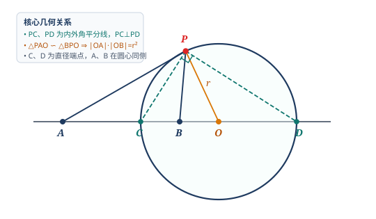

# 阿氏圆的五大核心几何性质与前置定理

> **来源**：补充专题（阿氏圆 2/4） ｜ **适用模块**：二、圆与方程

## 一、常用前置几何定理

### 1. 内、外角平分线定理（面积比例法证明）
- **内角平分线定理**：在 $\triangle ABC$ 中，若 $AD$ 是 $\angle BAC$ 的内角平分线（$D$ 在边 $BC$ 上），则有 $\frac{AB}{AC} = \frac{BD}{CD}$。
    - **证明（面积比例法）**：角平分线上的点 $D$ 到 $AB$、$AC$ 的距离相等（设为 $h_1$），且 $\triangle ABD$ 与 $\triangle ACD$ 同高（设为 $h_2$），故：

$$\frac{S_{\triangle ABD}}{S_{\triangle ACD}} = \frac{\frac{1}{2}AB \cdot h_1}{\frac{1}{2}AC \cdot h_1} = \frac{\frac{1}{2}BD \cdot h_2}{\frac{1}{2}CD \cdot h_2} \Rightarrow \frac{AB}{AC} = \frac{BD}{CD}$$

- **外角平分线定理**：在 $\triangle ABC$ 中，若 $\angle BAC$ 的外角平分线交边 $BC$ 的延长线于 $D$，同理用 $\frac{S_{\triangle ABD}}{S_{\triangle ACD}}$ 面积比例法可得 $\frac{AB}{AC} = \frac{BD}{CD}$。

### 2. 圆幂定理
| 定理名称 | 条件 | 核心结论 |
| --- | --- | --- |
| 相交弦定理 | 圆内两弦 $AC$、$BD$ 相交于点 $E$ | $|AE| \cdot |EC| = |DE| \cdot |EB|$ |
| 切割线定理 | $AB$ 切圆于 $B$，割线 $ACD$ 交圆于 $C$、$D$ | $|AB|^2 = |AC| \cdot |AD|$ |
| 割线定理 | 过圆外点 $A$ 作两割线 $ABD$、$ACE$ | $|AB| \cdot |AD| = |AC| \cdot |AE|$ |

## 二、阿氏圆的五大核心几何性质（含完整证明）

设 $A$、$B$ 为平面上两已知定点，$C$、$D$ 分别为线段 $AB$ 定比为 $\lambda\ (\lambda > 0 \text{ 且 } \lambda \neq 1)$ 的**内分点**（$C$ 在线段 $AB$ 上，满足 $\frac{|AC|}{|BC|} = \lambda$）与**外分点**（$D$ 在线段 $AB$ 或 $BA$ 延长线上，满足 $\frac{|AD|}{|BD|} = \lambda$），以 $CD$ 为直径的圆记为圆 $O$。

### 性质 1（轨迹等价与内外位置）
以 $CD$ 为直径的圆 $O$ 上任意一点 $P$ 到 $A$、$B$ 两点的距离之比恒为 $\lambda$。当 $\lambda > 1$ 时，点 $B$ 在圆内、点 $A$ 在圆外；当 $0 < \lambda < 1$ 时，点 $A$ 在圆内、点 $B$ 在圆外。

- **证明（以 $\lambda > 1$ 为例）**：设 $|AB| = 2a$，由 $\frac{|AC|}{|CB|} = \frac{|AD|}{|DB|} = \lambda$，得：

$$\begin{cases} |AC| = \frac{2a\lambda}{1 + \lambda}, \quad |CB| = \frac{2a}{1 + \lambda} \\ |AD| = \frac{2a\lambda}{\lambda - 1}, \quad |BD| = \frac{2a}{\lambda - 1} \end{cases}$$

过点 $B$ 作与直径 $CD$ 垂直的弦 $PQ$。由相交弦定理及勾股定理得：

$$\begin{cases} |BP|^2 = |CB| \cdot |BD| = \frac{4a^2}{\lambda^2 - 1} \\ |AP|^2 = |AB|^2 + |BP|^2 = 4a^2 + \frac{4a^2}{\lambda^2 - 1} = \frac{4a^2\lambda^2}{\lambda^2 - 1} \end{cases}$$

于是 $|BP| = \frac{2a}{\sqrt{\lambda^2 - 1}}$，$|AP| = \frac{2a\lambda}{\sqrt{\lambda^2 - 1}}$，从而 $\frac{|AP|}{|BP|} = \lambda$。又 $C$、$D$、$P$ 同时在到 $A$、$B$ 两点距离之比等于 $\lambda$ 的圆上，且不共线三点唯一确定一个圆，故圆 $O$ 上任意一点 $P$ 到 $A$、$B$ 两点的距离之比恒为 $\lambda$。

### 性质 2（共线同侧与半径公式）
由上述证明过程直接可知：圆心 $O$ 与两定点 $A$、$B$ 共线，且 $A$、$B$ 位于圆心 $O$ 的**同侧**；半径为：

$$r = \frac{1}{2}(|CB| + |BD|) = \left|\frac{2a\lambda}{\lambda^2 - 1}\right| = \left|\frac{|AB|}{\lambda - \frac{1}{\lambda}}\right|$$

### 性质 3（内外角平分线与垂直）
连接 $PC$、$PD$，则 $PC$、$PD$ 分别是 $\angle APB$ 的**内、外角平分线**，且 $PC \perp PD$（$\angle CPD = 90^\circ$）；$A$、$C$、$B$、$D$ 四点构成调和点列。

- **证明**：
    - 在 $\triangle ABP$ 中，因 $\frac{|PA|}{|PB|} = \frac{|CA|}{|CB|} = \lambda$，由内角平分线定理的逆定理知 **$PC$ 为 $\angle APB$ 的内角平分线**；
    - 因 $CD$ 为圆 $O$ 的直径，故 $\angle CPD = 90^\circ$，即 **$PC \perp PD$**；
    - 延长 $AP$ 至一点 $M$，因 $\angle CPB + \angle DPB = \angle CPD = 90^\circ$，且 $\angle APC + \angle DPM = 180^\circ - \angle CPD = 90^\circ$，又 $\angle CPB = \angle APC$，故 $\angle DPB = \angle DPM$，即 **$PD$ 为 $\angle APB$ 的外角平分线**。

### 性质 4（母子相似与反演积公式，高频大招）
连接 $OP$，易证 $\triangle PAO \sim \triangle BPO$，从而得到圆心到两定点距离的核心关系（可由一个定点快速反求另一个定点坐标）：

$$\begin{cases} |OA| \cdot |OB| = r^2 \\ |OA| = \lambda^2 |OB| \end{cases}$$

- **证明一（几何相似法）**：在 $\triangle OPC$ 中，$|OP| = |OC| = r$，故 $\angle OCP = \angle OPC = \angle OPB + \angle BPC$；又 $\angle OCP$ 为 $\triangle PAC$ 的外角，故 $\angle OCP = \angle PAC + \angle APC$。因 $PC$ 平分 $\angle APB$，有 $\angle BPC = \angle APC$，从而 $\angle OPB = \angle PAC$。又 $\angle AOP = \angle POB$（公共角），故 $\triangle PAO \sim \triangle BPO$，得：

$$\frac{|PA|}{|BP|} = \frac{|PO|}{|BO|} = \frac{|OA|}{|PO|} = \lambda \Rightarrow \begin{cases} |PO|^2 = |OA| \cdot |OB| \text{（即 } |OA| \cdot |OB| = r^2 \text{）} \\ |OA| = \lambda |PO| = \lambda^2 |OB| \end{cases}$$

- **证明二（代数坐标法）**：由标准建系知 $|OM| = \frac{\lambda^2 + 1}{\lambda^2 - 1}c$，故：

$$|OA| \cdot |OB| = (|OM| + c)(|OM| - c) = \left(\frac{\lambda^2 + 1}{\lambda^2 - 1}c\right)^2 - c^2 = \left(\frac{2\lambda c}{\lambda^2 - 1}\right)^2 = r^2$$

### 性质 5（过圆内定点的弦角平分性质）
过圆内定点 $B$ 作圆 $O$ 不与直径 $CD$ 重合的任意弦 $EF$，则直线 $AB$ 平分 $\angle EAF$。
