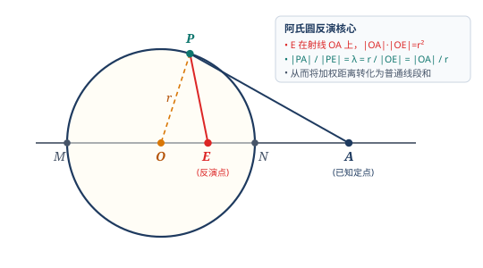
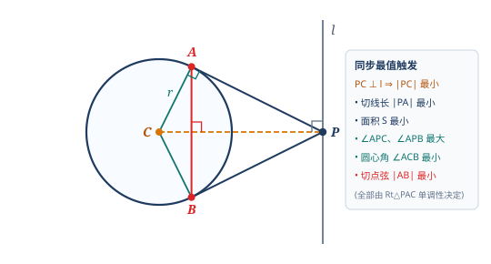

# 阿氏圆反演与最值转化策略

> **专题**：阿氏圆 3/3 ｜ **适用模块**：二、圆与方程

## 一、阿氏圆反演（已知圆与一定点，反求另一定点）

在最值小题中，常遇到动点 $P$ 在已知圆 $O$（半径为 $r$）上运动，求形如 $m|PA| + n|PB|$ 的加权线段和最小值。核心手段是**构造阿氏圆反演点**，把系数不为 $1$ 的项转化成等比例的新线段。

### 1. 构造与推导
已知圆 $O$（半径为 $r$）及定点 $A$，设直线 $OA$ 交圆 $O$ 于直径两端点 $M$、$N$，求射线 $OA$ 上的反演点 $E$，使得圆上任意动点 $P$ 均满足 $\frac{|PA|}{|PE|} = \lambda$。

由直径两端点 $N$、$M$ 均满足定比关系，联立：

$$\begin{cases} |AN| = \lambda |EN| \Rightarrow |OA| - r = \lambda (r - |OE|) \Rightarrow \lambda |OE| = (1 + \lambda)r - |OA| \\ |AM| = \lambda |EM| \Rightarrow |OA| + r = \lambda (r + |OE|) \Rightarrow \lambda |OE| = (1 - \lambda)r + |OA| \end{cases}$$

两式相加得 $2\lambda |OE| = 2r$，即 $\lambda |OE| = r$；代回上式即得核心反演结论：

$$\begin{cases} |OA| \cdot |OE| = r^2 \\ \lambda = \frac{r}{|OE|} = \frac{|OA|}{r} \\ \lambda^2 = \frac{|OA|}{|OE|} \end{cases}$$

### 2. 反演转化口诀
- 点 $E$ 必落在**圆心 $O$ 与定点 $A$ 的连线上（同侧）**；
- 若定点 $A$ 在圆外，反演点 $E$ 在圆内（$|OE| = \frac{r^2}{|OA|}$），且 $|PA| = \frac{|OA|}{r}|PE|$；
- 若定点 $A$ 在圆内，反演点 $E$ 在圆外（$|OE| = \frac{r^2}{|OA|}$），且 $|PE| = \frac{r}{|OA|}|PA|$；
- 转化后即可将 $\lambda|PE| + |PB|$ 或 $|PA| + \mu|PB|$ 化为无系数折线和，利用**三点共线（两点之间线段最短）**一步求最值。

## 二、圆外动点切线长同步最值链（含单调性证明）

设动点 $P$ 在圆 $C$（半径为 $r$）外的直线 $l$ 上运动，过 $P$ 作圆 $C$ 的两条切线 $PA$、$PB$（切点为 $A$、$B$）。

### 1. 为什么 $|PC|$ 最小时，这一整条链同步取到最值？（逐步推导）

**① 源头触发：$|PC|$ 何时最小？**

- 由平面几何「垂线段最短」，当且仅当 **$PC \perp l$** 时，圆心到动点距离 $|PC|$ 取得唯一最小值 $d_{C \to l}$（直线无端点，故 $|PC|$ 与 $|PA|$ 均无最大值）。

**② 切线长 $|PA|$ 同步最小（同向单调）**

- 在 $\text{Rt}\triangle PAC$ 中，由勾股定理得：

$$|PA| = \sqrt{|PC|^2 - r^2}$$

- 因 $r$ 为定值，$|PA|$ 关于 $|PC|$ **严格单调递增**，故 $|PC|$ 最小 $\Leftrightarrow |PA|$ 最小，且 $|PA|_{\min} = \sqrt{d_{C \to l}^2 - r^2}$。

**③ 面积 $S_{\triangle PAC}$ 与 $S_{\text{四边形}PACB}$ 同步最小（正比单调）**

- 因 $CA \perp PA$ 且 $\triangle PAC \cong \triangle PBC$，有：

$$\begin{cases} S_{\triangle PAC} = \frac{1}{2} r \cdot |PA| \\ S_{\text{四边形}PACB} = 2 S_{\triangle PAC} = r \cdot |PA| \end{cases}$$

- 两者均与 $|PA|$ 成正比，故 $|PA|$ 最小时两面积同步取得最小值。

**④ 切线半角 $\angle APC$ 与整角 $\angle APB$ 同步最大（反向单调）**

- 在 $\text{Rt}\triangle PAC$ 中，有 $\sin \angle APC = \frac{r}{|PC|}$ 且 $\tan \angle APC = \frac{r}{|PA|}$，其中 $\angle APC \in \left(0,\; \frac{\pi}{2}\right)$。
- 因 $\sin \theta$ 与 $\tan \theta$ 在 $\left(0,\; \frac{\pi}{2}\right)$ 上均**严格单调递增**，当分母 $|PC|$（及 $|PA|$）**越小**时，分数值 $\frac{r}{|PC|}$、$\frac{r}{|PA|}$ **越大**，故 $|PC|$ 最小 $\Leftrightarrow \angle APC$ **最大** $\Leftrightarrow \angle APB = 2\angle APC$ **最大**。

**⑤ 圆心角 $\angle ACB$ 同步最小（互补反向）**

- 在四边形 $PACB$ 中，$\angle PAC = \angle PBC = 90^\circ$，故 $\angle ACB + \angle APB = 180^\circ$（互补）。
- 因此 $\angle APB$ 最大 $\Leftrightarrow \angle ACB = 180^\circ - \angle APB$ **最小**。

**⑥ 切点弦长 $|AB|$ 同步最小（双证法一眼看透）**

- **证法一（圆心角单调性）**：在等腰 $\triangle ACB$ 中，$|AB| = 2r \sin \frac{\angle ACB}{2}$，因 $\frac{\angle ACB}{2} \in \left(0,\; \frac{\pi}{2}\right)$ 且正弦函数在此区间单调递增，故 $\angle ACB$ 最小 $\Leftrightarrow |AB|$ **最小**。
- **证法二（等面积法直接看函数单调性）**：因 $PC \perp AB$，由 $S_{\text{四边形}PACB} = r|PA| = \frac{1}{2}|AB| \cdot |PC|$ 解出：

$$|AB| = \frac{2r|PA|}{|PC|} = 2r \cdot \frac{\sqrt{|PC|^2 - r^2}}{|PC|} = 2r\sqrt{1 - \frac{r^2}{|PC|^2}}$$

- 由此一目了然：$|PC|$ 越小 $\Rightarrow \frac{r^2}{|PC|^2}$ 越大 $\Rightarrow 1 - \frac{r^2}{|PC|^2}$ 越小 $\Rightarrow |AB|$ **越小**。

### 2. 同步最值链速查表

$$|PC|_{\min}\;(PC \perp l) \;\Rightarrow\; |PA|_{\min} \;\Rightarrow\; S_{\min} \;\Rightarrow\; (\angle APC,\; \angle APB)_{\max} \;\Rightarrow\; (\angle ACB)_{\min} \;\Rightarrow\; |AB|_{\min}$$

| 关联量 | 最值表达式 / 关键推导式 |
| --- | --- |
| 切线长 $|PA|$ | $|PA|_{\min} = \sqrt{d_{C \to l}^2 - r^2}$ |
| $\triangle PAC$ 面积 | $(S_{\triangle PAC})_{\min} = \frac{1}{2} r \cdot |PA|_{\min}$ |
| 四边形 $PACB$ 面积 | $(S_{\text{四边形}PACB})_{\min} = r \cdot |PA|_{\min} = \frac{1}{2}(|AB| \cdot |PC|)_{\min}$ |
| $\tan \angle APC$ / $\sin \angle APC$ | $(\tan \angle APC)_{\max} = \frac{r}{|PA|_{\min}}$，$(\sin \angle APC)_{\max} = \frac{r}{|PC|_{\min}}$ |
| 切线夹角与圆心角 | $\angle APB = 2\angle APC$ 最大 $\Leftrightarrow \angle ACB = 180^\circ - \angle APB$ 最小 |
| 切点弦长 $|AB|$ | $|AB|_{\min} = 2r\sqrt{1 - \frac{r^2}{d_{C \to l}^2}} = 2r \sin \frac{(\angle ACB)_{\min}}{2}$ |
