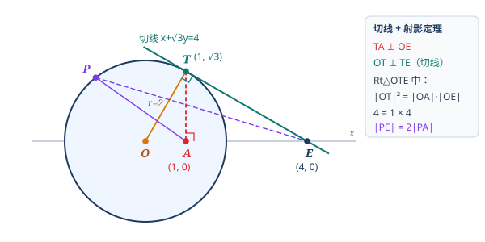
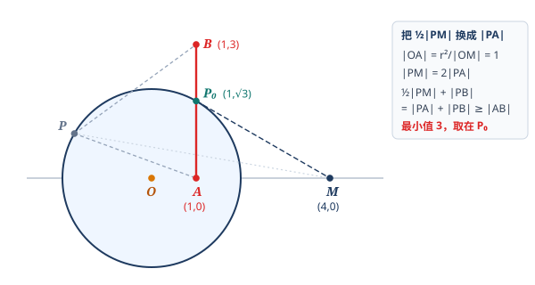

# 求阿氏圆反演点的五种方法（汇总）

> **来源**：补充专题（阿氏圆 4/4） ｜ **适用模块**：二、圆与方程

**问题**：已知圆 $O$（半径 $r$）和一个定点 $A$，在直线 $OA$ 上找另一个定点 $E$，使圆上任意一点 $P$ 都满足 $\frac{|PA|}{|PE|}$ 为定值。

五种方法求出的是同一个点，依据都是同一个结论：

$$|OA| \cdot |OE| = r^2, \qquad E \text{ 与 } A \text{ 在 } O \text{ 的同侧}$$

一个在圆内，另一个就在圆外。各方法的详细推导仍在原来的位置，这里只把它们放在一起对照。

## 一、五种方法一览

| 方法 | 怎么做 | 适合什么时候用 | 详细内容在哪 |
| --- | --- | --- | --- |
| ① 直径两端点法 | 直线 $OA$ 交圆于 $M$、$N$，两端点都满足定比，列两个方程联立 | 忘了公式时现场推，只用到线段长 | 「阿氏圆反演与最值转化策略」一、1 |
| ② 母子相似 | $\triangle PAO \sim \triangle EPO$，得 $|OP|^2 = |OA| \cdot |OE|$ | 理解公式从哪来，几何证明题 | 「阿氏圆的五大核心几何性质」性质 4 |
| ③ 公式直接算 | $|OE| = \frac{r^2}{|OA|}$，或向量 $\overrightarrow{OE} = \frac{r^2}{|OA|^2}\overrightarrow{OA}$ | 选择填空最快 | 「阿氏圆反演与最值转化策略」一、1 |
| ④ 切线 + 射影定理作图 | 过 $A$ 作 $OA$ 的垂线交圆于 $T$，$T$ 处切线交射线 $OA$ 于 $E$ | 作图题，或想直观看出 $E$ 在哪 | 「阿氏圆反演与最值转化策略」一、3（1） |
| ⑤ 待定系数法 | 设 $E$ 坐标，$|PE|^2 = \lambda^2|PA|^2$ 对圆上所有点恒成立，比较系数 | 圆心不在原点、$A$ 不在坐标轴上，最稳 | 「阿氏圆反演与最值转化策略」一、3（2） |

比值也一起记住，口诀是「==外比内，等于 $\frac{|O外|}{r}$==」：

$$\frac{|P\text{外}|}{|P\text{内}|} = \frac{|O\text{外}|}{r} = \frac{r}{|O\text{内}|} > 1$$

这里「外」「内」分别指圆外、圆内的那个定点。

## 二、同一道题，五种方法各做一遍

**例 1**　圆 $O$：$x^2 + y^2 = 4$，$A(1, 0)$。求 $x$ 轴上的点 $E$，使圆上任意一点 $P$ 都有 $\frac{|PE|}{|PA|}$ 为定值。

**① 直径两端点法**：直线 $OA$ 交圆于 $M(-2, 0)$、$N(2, 0)$，$|AN| = 1$，$|AM| = 3$。设 $E(t, 0)$，$t > 2$，则 $|EN| = t - 2$，$|EM| = t + 2$。两端点的比值相等：

$$\frac{|AN|}{|EN|} = \frac{|AM|}{|EM|} \;\Rightarrow\; \frac{1}{t - 2} = \frac{3}{t + 2} \;\Rightarrow\; t = 4$$

**② 母子相似**：$\triangle PAO$ 与 $\triangle EPO$ 有公共角 $\angle O$，且 $\frac{|OA|}{|OP|} = \frac{|OP|}{|OE|}$，所以相似，$|OP|^2 = |OA| \cdot |OE|$，即 $4 = 1 \cdot |OE|$，$|OE| = 4$。

**③ 公式**：$|OE| = \frac{r^2}{|OA|} = \frac{4}{1} = 4$。或者用向量：$\overrightarrow{OE} = \frac{4}{1}(1, 0) = (4, 0)$。

**④ 切线 + 射影定理**：过 $A$ 作垂线 $x = 1$ 交圆于 $T(1, \sqrt{3})$，切线 $x + \sqrt{3} y = 4$ 交 $x$ 轴于 $(4, 0)$。

**⑤ 待定系数**：设 $E(t, 0)$，由 $4 + t^2 - 2tx = \lambda^2(5 - 2x)$ 恒成立，得 $t = \lambda^2$、$4 + t^2 = 5\lambda^2$，解得 $t = 4$（$t = 1$ 时与 $A$ 重合，舍去）。

五种方法都得 ==$E(4, 0)$，$|PE| = 2|PA|$==。

## 三、应用：用反演点求加权距离和的最小值

**例 2**　点 $P$ 在圆 $x^2 + y^2 = 4$ 上，$M(4, 0)$，$B(1, 3)$。求 $\frac{1}{2}|PM| + |PB|$ 的最小值。

**解**：系数 $\frac{1}{2}$ 乘在圆外点 $M$ 的距离上，就把 $M$ 换成圆内的反演点。

由 ③，$|OA| = \frac{r^2}{|OM|} = \frac{4}{4} = 1$，所以 $A(1, 0)$；比值 $\frac{|PM|}{|PA|} = \frac{|OM|}{r} = 2$，即 $\frac{1}{2}|PM| = |PA|$。于是

$$\frac{1}{2}|PM| + |PB| = |PA| + |PB| \ge |AB| = 3$$

$A$ 在圆内，$B$ 在圆外（$1 + 9 > 4$），线段 $AB$ 与圆交于 $P_0(1, \sqrt{3})$，等号能取到。所以最小值为 ==$3$==。

**注意**：要先确认换完以后的两个点分别在圆的两侧，线段才会穿过圆，等号才取得到。如果两点都在圆外且线段不穿过圆，就不能直接用三点共线。

