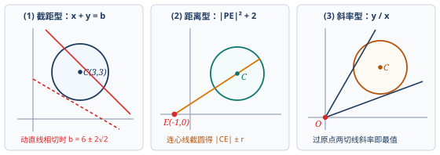

# 与圆有关的最值问题（几何意义 + 参数方程法，含例 18）

> **专题**：圆的最值 1/2 ｜ **适用模块**：二、圆与方程

## 一、利用几何意义求最值的三大模型

| 模型类型 | 代数形式 | 几何转化思路 |
| --- | --- | --- |
| **1. 截距型** | $ax + by$ | 设 $z = ax + by$，转化为动直线 $ax + by - z = 0$ 与圆相切时的截距最值（圆心到直线距离 $d = r$）；也可用**圆的参数方程**化为三角辅助角求最值。 |
| **2. 距离型** | $(x - a)^2 + (y - b)^2$ | 转化为圆上动点 $(x, y)$ 到定点 $(a, b)$ 距离的平方最值（$|PC|_{\max/\min} = |EC| \pm r$）。 |
| **3. 斜率型** | $\frac{y - b}{x - a}$ | 转化为过定点 $(a, b)$ 与圆上动点的动直线斜率 $k$ 的最值，当直线与圆相切时取得（$d = r$）。 |

## 二、经典例题（例 18，含截距/距离/斜率三型及参数方程法）

**例 18**：已知点 $P(x, y)$ 在圆 $C: x^2 + y^2 - 6x - 6y + 14 = 0$ 上。

- (1) 求 $x + y$ 的最大值与最小值；
- (2) 求 $x^2 + y^2 + 2x + 3$ 的最大值与最小值；
- (3) 求 $\frac{y}{x}$ 的最大值与最小值。

**解析**：先配方得圆标准方程 $(x - 3)^2 + (y - 3)^2 = 4$，圆心 $C(3, 3)$，半径 $r = 2$。

### (1) 求 $x + y$ 的最值（两种方法）
- **方法一（几何意义：截距型 + 相切法）**：
    - 设 $x + y = b$，即动直线 $y = -x + b$（$b$ 为 $y$ 轴截距）。当直线与圆相切时 $b$ 取最值，由圆心 $C(3, 3)$ 到直线 $x + y - b = 0$ 的距离等于半径 $2$ 得：

$$\frac{|3 + 3 - b|}{\sqrt{1^2 + 1^2}} = 2 \Rightarrow |b - 6| = 2\sqrt{2} \Rightarrow b = 6 \pm 2\sqrt{2}$$

- 故 $x + y$ 最大值为 $6 + 2\sqrt{2}$，最小值为 $6 - 2\sqrt{2}$。
- **方法二（圆的参数方程 + 辅助角公式）**：
    - 设圆的参数方程为：

$$\begin{cases} x = 3 + 2\cos\alpha \\ y = 3 + 2\sin\alpha \end{cases} \quad (\alpha \in R)$$

- 代入得：

$$x + y = 6 + 2(\sin\alpha + \cos\alpha) = 6 + 2\sqrt{2}\sin\left(\alpha + \frac{\pi}{4}\right)$$

- 当 $\alpha + \frac{\pi}{4} = 2k\pi + \frac{\pi}{2}\ (k \in Z)$ 时取最大值 $6 + 2\sqrt{2}$；当 $\alpha + \frac{\pi}{4} = 2k\pi - \frac{\pi}{2}\ (k \in Z)$ 时取最小值 $6 - 2\sqrt{2}$。

### (2) 求 $x^2 + y^2 + 2x + 3$ 的最值（距离型）
- 配方化为 $(x + 1)^2 + y^2 + 2$，表示圆上点 $P$ 到定点 $E(-1, 0)$ 的距离平方再加 $2$。
- 因 $|CE| = \sqrt{(3 + 1)^2 + 3^2} = 5 > 2$，点 $E$ 在圆外，故 $|PE|_{\max} = 5 + 2 = 7$，$|PE|_{\min} = 5 - 2 = 3$；
- 从而最大值为 $7^2 + 2 = 51$，最小值为 $3^2 + 2 = 11$。

### (3) 求 $\frac{y}{x}$ 的最值（斜率型）
- $\frac{y}{x}$ 表示圆上点 $P$ 与原点 $O(0, 0)$ 连线的斜率。当过原点的直线 $y = kx$（即 $kx - y = 0$）与圆相切时斜率取最值：

$$\frac{|3k - 3|}{\sqrt{k^2 + 1}} = 2 \Rightarrow k = \frac{9 \pm 2\sqrt{14}}{5}$$

- 故 $\frac{y}{x}$ 的最大值为 $\frac{9 + 2\sqrt{14}}{5}$，最小值为 $\frac{9 - 2\sqrt{14}}{5}$。

## 三、圆上点到直线距离最值、定距点数与最长/最短弦

- **圆上点到直线距离最值**（圆心到直线距离 $d$，半径 $r$）：
    - 相交（$d < r$）：最小 $0$，最大 $r + d$；相切（$d = r$）：最小 $0$，最大 $2r$；相离（$d > r$）：最小 $d - r$，最大 $r + d$。
- **圆上到直线距离为定值 $d_r$ 的点个数**：
    - $0$ 个：$d_r > d + r$ 或 $d_r < d - r\ (d \ge r)$；$1$ 个：$d_r = d + r$ 或 $d_r = d - r\ (d \ge r)$；$2$ 个：$|r - d| < d_r < r + d$；$3$ 个：$d_r = r - d\ (d < r)$；$4$ 个：$d_r < r - d\ (d < r)$。
- **过圆内一点 $M$ 的最长弦与最短弦**：最长弦为过 $M$ 的**直径**（长 $2r$）；最短弦为**与 $CM$ 垂直的弦**（长 $2\sqrt{r^2 - |CM|^2}$）。
