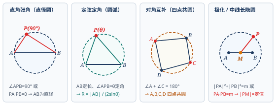

# 隐圆问题七大模型：隐圆在哪？为什么是圆？（含证明与实战例题）

> **来源**：补充专题（隐圆专题 2/2） ｜ **适用模块**：二、圆与方程

*(核心心法：很多小题题干里压根没出现“圆”字，却暗藏动点满足圆的几何或代数条件——这就是**隐圆**。一旦把隐藏的圆心和半径挖出来，难题立刻退化为「点与圆、线与圆、圆与圆的位置关系」送分题！)*

## 一、七大常见隐圆模型与严格证明

### 模型 1：定义型（到定点距离等于定长）
- **特征**：$|PM| = r$（$M$ 为定点，$r > 0$ 为定长），或动点坐标形如 $\begin{cases} x = a + r\cos\theta \\ y = b + r\sin\theta \end{cases}$。
- **为什么是圆**：由圆的定义直接知 $P$ 在以 $M$ 为圆心、$r$ 为半径的圆上（参数方程消参即得 $(x - a)^2 + (y - b)^2 = r^2$）。

### 模型 2：直角张角型（出现 $90^\circ$ 或 $\overrightarrow{PA} \cdot \overrightarrow{PB} = 0$）
- **特征**：两定点 $A(x_1, y_1)$、$B(x_2, y_2)$，动点 $P$ 满足 $\angle APB = 90^\circ$ 或 $\overrightarrow{PA} \cdot \overrightarrow{PB} = 0$（常见于动直线垂直交点、如两条过定点的互相垂直直线交点）。
- **为什么是圆**：由直径所对圆周角为 $90^\circ$ 的逆定理（或代数展开 $(x - x_1)(x - x_2) + (y - y_1)(y - y_2) = 0$），$P$ 的轨迹是以 **$AB$ 为直径的圆**（圆心为 $AB$ 中点，半径 $r = \frac{1}{2}|AB|$；若为 $\angle APB = 90^\circ$ 须挖去 $A$、$B$ 两点）。

### 模型 3：向量数量积定值型（$\overrightarrow{PA} \cdot \overrightarrow{PB} = m$）
- **特征**：两定点 $A$、$B$，动点 $P$ 满足 $\overrightarrow{PA} \cdot \overrightarrow{PB} = m$（$m$ 为常数）。
- **证明（极化恒等式）**：取线段 $AB$ 的中点 $M$，则 $\overrightarrow{PA} = \overrightarrow{PM} + \overrightarrow{MA}$，$\overrightarrow{PB} = \overrightarrow{PM} - \overrightarrow{MA}$，故：

$$\overrightarrow{PA} \cdot \overrightarrow{PB} = |\overrightarrow{PM}|^2 - |\overrightarrow{MA}|^2 = |PM|^2 - \frac{|AB|^2}{4} = m \Rightarrow |PM|^2 = m + \frac{|AB|^2}{4}$$

- **结论**：当 $m + \frac{|AB|^2}{4} > 0$ 时，动点 $P$ 在以 **$AB$ 中点 $M$ 为圆心、$r = \sqrt{m + \frac{|AB|^2}{4}}$ 为半径**的隐圆上！

### 模型 4：距离平方和定值型（$|PA|^2 + |PB|^2 = m$）
- **特征**：两定点 $A$、$B$，动点 $P$ 满足 $|PA|^2 + |PB|^2 = m$（$m$ 为常数）。
- **证明（中线长定理 / 向量展开）**：取 $AB$ 中点 $M$，因 $\overrightarrow{MA} + \overrightarrow{MB} = \vec{0}$：

$$|PA|^2 + |PB|^2 = |\overrightarrow{PM} + \overrightarrow{MA}|^2 + |\overrightarrow{PM} - \overrightarrow{MA}|^2 = 2|PM|^2 + 2|MA|^2 = 2|PM|^2 + \frac{|AB|^2}{2} = m$$

整理得：

$$|PM|^2 = \frac{m}{2} - \frac{|AB|^2}{4}$$

- **结论**：当 $m > \frac{|AB|^2}{2}$ 时，动点 $P$ 在以 **$AB$ 中点 $M$ 为圆心、$r = \sqrt{\frac{m}{2} - \frac{|AB|^2}{4}}$ 为半径**的隐圆上！

### 模型 5：定弦定角型（定线段 $AB$ 对动点张角 $\angle APB = \theta$ 为定值）
- **特征**：线段 $AB$ 长度固定，动点 $P$ 满足 $\angle APB = \theta$（定角）。
- **证明（正弦定理）**：在 $\triangle APB$ 中，其外接圆半径满足：

$$R = \frac{|AB|}{2\sin\theta} = \text{定值}$$

- **结论**：动点 $P$ 的轨迹是以 $AB$ 为弦、半径为 $R = \frac{|AB|}{2\sin\theta}$ 的**两段对称圆弧**（$\theta = 90^\circ$ 时拼成完整圆；$\theta$ 为锐角对应优弧、钝角对应劣弧；常见于求三角形面积或边长最值）。

### 模型 6：对角互补 / 四点共圆型（圆内接四边形）
- **特征**：四边形 $ABCD$ 中发现对角之和 $\angle A + \angle C = 180^\circ$（最高频的是「双直角」$\angle A = \angle C = 90^\circ$），或同侧两张角相等 $\angle ADB = \angle ACB$。
- **为什么是圆**：由圆内接四边形判定定理，对角互补则 $A$、$B$、$C$、$D$ 四点必共圆；一旦其中三点（或公共斜边 $BD$）固定，第四个动点就被锁定在这个外接隐圆上。

### 模型 7：距离定比型（阿波罗尼斯圆）
- **特征**：两定点 $A$、$B$，动点 $P$ 满足 $\frac{|PA|}{|PB|} = \lambda\ (\lambda > 0 \text{ 且 } \lambda \neq 1)$。
- **为什么是圆**：即本模块「3. 阿波罗尼斯圆（阿氏圆）」，以定比内分点 $P_1$ 与外分点 $P_2$ 为直径的圆。

## 二、实战示例：一眼挖出隐圆秒杀最值

**示例（源自《教材帮》例 15）**：已知 $Q$ 是圆 $O: x^2 + y^2 = 1$ 上任意一点，定点 $A(-2, 2)$、$B(-6, 4)$，动点 $P$ 满足 $|PA|^2 + |PB|^2 = 18$，求 $|PQ|$ 的最小值。

- **隐圆在哪？** 看到 $|PA|^2 + |PB|^2 = 18$ 立刻命中**模型 4（距离平方和定值型）**！
- **两步秒解**：
    1. 算 $AB$ 中点 $M\left(\frac{-2-6}{2},\; \frac{2+4}{2}\right) = (-4, 3)$，且 $|AB|^2 = (-6 + 2)^2 + (4 - 2)^2 = 20$，直接套公式得隐圆半径：

$$r = \sqrt{\frac{18}{2} - \frac{20}{4}} = \sqrt{9 - 5} = 2$$

       即动点 $P$ 的隐圆为 $(x + 4)^2 + (y - 3)^2 = 4$（圆心 $M(-4, 3)$，半径 $r = 2$）。
    2. 转化为两圆距离最值：圆心距 $|OM| = \sqrt{(-4)^2 + 3^2} = 5 > 2 + 1$（两圆外离），故：

$$|PQ|_{\min} = |OM| - r - 1 = 5 - 2 - 1 = 2$$
