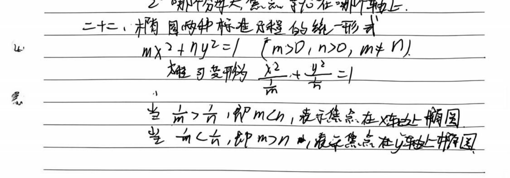
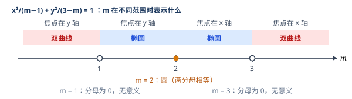

# 椭圆两种标准方程的统一形式

> **原稿序号**：大写 二十二、 ｜ **原稿页码**：P9 ｜ **所属模块**：三、椭圆 → 1. 定义、标准方程与几何性质

## 补充：方程表示椭圆的参数范围（易错）

**例**　方程 $\frac{x^2}{m - 1} + \frac{y^2}{3 - m} = 1$ 表示椭圆，求 $m$ 的范围；表示焦点在 $y$ 轴上的椭圆呢？

**解**：两个分母都为正，而且==不能相等==（相等时是圆）：

$$\begin{cases} m - 1 > 0 \\ 3 - m > 0 \\ m - 1 \ne 3 - m \end{cases} \;\Rightarrow\; 1 < m < 3 \text{ 且 } m \ne 2$$

焦点在 $y$ 轴上，要求 $y^2$ 的分母更大：$3 - m > m - 1 > 0$，得 ==$1 < m < 2$==。

用统一形式 $mx^2 + ny^2 = 1$ 说就是：表示椭圆 $\Leftrightarrow$ $m > 0$，$n > 0$，$m \ne n$；焦点在 $x$ 轴上 $\Leftrightarrow$ $0 < m < n$（系数小的那个对应的分母大）。

## 补充：$mx^2 + ny^2 = 1$ 表示什么曲线（完整分类）

| $m$、$n$ 的条件 | 曲线 | 焦点位置 |
| --- | --- | --- |
| $m > 0$，$n > 0$，$m \ne n$ | 椭圆 | $m < n$ 时在 $x$ 轴上，$m > n$ 时在 $y$ 轴上 |
| $m = n > 0$ | 圆 | — |
| $mn < 0$ | 双曲线 | $m > 0 > n$ 时在 $x$ 轴上，$n > 0 > m$ 时在 $y$ 轴上 |
| 一个为 $0$，另一个为正 | 两条平行直线（如 $m = 0$，$n > 0$ 时是 $y = \pm \frac{1}{\sqrt{n}}$） | — |
| $m \le 0$ 且 $n \le 0$ | 不表示任何曲线（左边 $\le 0$，不可能等于 $1$） | — |

判断焦点位置：椭圆看==分母大的==那一项（系数小的那一项），双曲线看==正号==那一项。

## 补充：同一个方程问双曲线

**例（续）**　方程 $\frac{x^2}{m - 1} + \frac{y^2}{3 - m} = 1$ 表示双曲线，求 $m$ 的范围；表示焦点在 $x$ 轴上的双曲线呢？

**解**：两个分母异号：$(m - 1)(3 - m) < 0$，得 ==$m < 1$ 或 $m > 3$==。

焦点在 $x$ 轴上，要求 $x^2$ 的分母为正、$y^2$ 的分母为负：$m - 1 > 0$ 且 $3 - m < 0$，得 ==$m > 3$==。同理，焦点在 $y$ 轴上时 $m < 1$。

把 $m$ 的所有取值放到一条数轴上看：

## 易错：充分条件与必要条件

**例**　「$1 < m < 3$」是「方程 $\frac{x^2}{m - 1} + \frac{y^2}{3 - m} = 1$ 表示椭圆」的什么条件？

**答**：==必要不充分条件==。方程表示椭圆时一定有 $1 < m < 3$；但 $m = 2$ 时方程是圆 $x^2 + y^2 = 1$，所以反过来不成立。

同理，「$m > 3$」是「方程表示双曲线」的充分不必要条件，因为 $m < 1$ 时也是双曲线。
