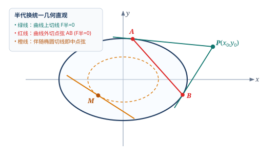

# 半代换法则与切线、切点弦、交点轨迹的统一

> **专题**：切线统一体系 1/3 ｜ **适用模块**：七、第三定义、垂径定理、中点弦与光学性质

*(背景说明：本专题用一套统一的「半代换法则」打通圆、椭圆、双曲线、抛物线的切线、切点弦、切线交点轨迹与中点弦；其高等几何背景为射影几何中的「极点与极线」，高考阶段只需掌握下述「一套公式 + 三种几何翻译 + 规范推导」即可。)*

## 一、核心口诀：半代换法则（降幂替换）

对于任意圆锥曲线 $F(x, y) = 0$ 与给定定点 $P(x_0, y_0)$，按以下完全统一的规则将原曲线方程改写为一条直线方程（记作 $F_{\text{半}}(x, y) = 0$）：

- **二次项拆一半**：$x^2 \to x_0 x$，$y^2 \to y_0 y$，$(x - a)^2 \to (x_0 - a)(x - a)$；
- **一次项取平均**：$x \to \frac{x + x_0}{2}$，$y \to \frac{y + y_0}{2}$（注：$2x \to x + x_0$）；
- **拓展（交叉项）**：若含 $xy$ 项，则替换为 $\frac{x_0 y + y_0 x}{2}$；常数项不变。

| 曲线类型 | 原曲线方程 $F(x, y) = 0$ | 点 $P(x_0, y_0)$ 对应的半代换直线 $F_{\text{半}}(x, y) = 0$ |
| --- | --- | --- |
| 标准圆 | $x^2 + y^2 = r^2$ | $x_0 x + y_0 y = r^2$ |
| 一般圆 | $(x - a)^2 + (y - b)^2 = r^2$ | $(x_0 - a)(x - a) + (y_0 - b)(y - b) = r^2$ |
| 椭圆 | $\frac{x^2}{a^2} + \frac{y^2}{b^2} = 1$ | $\frac{x_0 x}{a^2} + \frac{y_0 y}{b^2} = 1$ |
| 双曲线 | $\frac{x^2}{a^2} - \frac{y^2}{b^2} = 1$ | $\frac{x_0 x}{a^2} - \frac{y_0 y}{b^2} = 1$ |
| 抛物线 | $y^2 = 2px$ | $y_0 y = p(x + x_0)$ |
| 通用二次曲线 | $Ax^2 + Cy^2 + Dx + Ey + F = 0$ | $Ax_0 x + Cy_0 y + D\frac{x + x_0}{2} + E\frac{y + y_0}{2} + F = 0$ |

## 二、同一个方程的三种几何翻译（全看点 $P(x_0, y_0)$ 在哪）

上面表格右侧写出的**同一个直线方程**，随着定点 $P(x_0, y_0)$ 与曲线的相对位置不同，代表三种截然不同的几何对象（对圆、椭圆、双曲线、抛物线**全部成立**）：

| 点 $P(x_0, y_0)$ 的位置 | 方程 $F_{\text{半}}(x, y) = 0$ 的几何意义 | 细节与避坑点 |
| --- | --- | --- |
| **1. 在曲线上** | 过点 $P$ 的**切线方程** | 直线与曲线相切于点 $P$。 |
| **2. 在曲线外** | 过点 $P$ 作两条切线，两切点连线所在的**切点弦方程** | 对双曲线而言，「外部」指**不含焦点的区域**（且不在渐近线上），从此处可向双曲线作两条切线。 |
| **3. 在曲线内** | 过点 $P$ 任作一条弦 $AB$，分别过 $A$、$B$ 作切线，**两切线交点 $Q$ 的轨迹方程** | 对圆和椭圆，$P$ 不能是中心 $(0, 0)$（过中心的弦两端切线平行无交点）；对双曲线，「内部」指含焦点的区域；对抛物线，「内部」指开口内侧。 |
