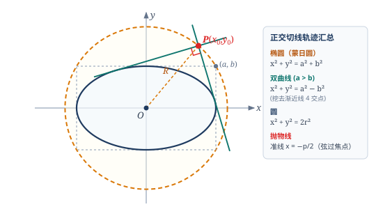

# 蒙日圆与四种曲线的正交切线轨迹（含完整证明）

> **专题**：蒙日圆独立专题 ｜ **适用模块**：七、第三定义、垂径定理、中点弦与光学性质

*(说明：本专题讨论「过曲线外一点作两条**互相垂直**的切线，交点 $P$ 的轨迹」，属于**正交切线轨迹**体系，与前面的半代换法则并非同一推导链路；核心证法均为联立切线 $\Delta = 0$ 得关于斜率 $k$ 的一元二次方程，再由韦达定理 $k_1 k_2 = -1$ 求解。)*

## 一、四种圆锥曲线的正交切线轨迹汇总

| 曲线类型 | 原曲线方程 | 两条互相垂直切线交点 $P$ 的轨迹 | 关键限制与联动性质 |
| --- | --- | --- | --- |
| **椭圆（蒙日圆/准圆）** | $\frac{x^2}{a^2} + \frac{y^2}{b^2} = 1$ | 圆 $x^2 + y^2 = a^2 + b^2$ | 完整圆，包含外切矩形的 4 个顶点 $(\pm a, \pm b)$。 |
| **双曲线（蒙日圆）** | $\frac{x^2}{a^2} - \frac{y^2}{b^2} = 1$ | 当 $a > b$ 时，圆 $x^2 + y^2 = a^2 - b^2$ | 须**挖去与渐近线的 4 个交点**；若 $a \le b$ 则**不存在**互相垂直的切线。 |
| **圆** | $x^2 + y^2 = r^2$ | 同心圆 $x^2 + y^2 = 2r^2$ | 两切线与两半径围成边长为 $r$ 的正方形，$|OP| = \sqrt{2}r$。 |
| **抛物线** | $y^2 = 2px\ (p > 0)$ | **准线** $x = -\frac{p}{2}$ | 联动结论：此时**切点弦 $AB$ 恒过焦点 $F\left(\frac{p}{2}, 0\right)$**。 |

## 二、逐一完整证明

### 1. 椭圆蒙日圆（$x^2 + y^2 = a^2 + b^2$）的证明
设交点 $P(x_0, y_0)$：

- **特殊情形（一条水平、一条竖直切线）**：此时 $P$ 为椭圆外切矩形的 4 个顶点 $(\pm a, \pm b)$，显然满足 $x_0^2 + y_0^2 = a^2 + b^2$。
- **一般情形（两切线斜率均存在且非零）**：设切线斜率为 $k$，方程为 $y = kx + (y_0 - kx_0)$。联立椭圆 $\frac{x^2}{a^2} + \frac{y^2}{b^2} = 1$，由相切条件 $\Delta = 0$ 得：

$$(y_0 - kx_0)^2 = a^2 k^2 + b^2$$

整理为关于切线斜率 $k$ 的一元二次方程：

$$(x_0^2 - a^2)k^2 - 2x_0 y_0 k + (y_0^2 - b^2) = 0$$

两切线斜率 $k_1$、$k_2$ 为该方程的两根。由两切线互相垂直 $\Leftrightarrow k_1 k_2 = -1$，结合韦达定理得：

$$k_1 k_2 = \frac{y_0^2 - b^2}{x_0^2 - a^2} = -1 \Rightarrow y_0^2 - b^2 = -(x_0^2 - a^2) \Rightarrow x_0^2 + y_0^2 = a^2 + b^2$$

综上，交点 $P$ 的轨迹方程为圆 $x^2 + y^2 = a^2 + b^2$。

### 2. 双曲线蒙日圆（$x^2 + y^2 = a^2 - b^2,\; a > b$）的证明
与椭圆推导完全平行（只需将 $b^2$ 替换为 $-b^2$）：过 $P(x_0, y_0)$ 的切线联立双曲线 $\frac{x^2}{a^2} - \frac{y^2}{b^2} = 1$ 由 $\Delta = 0$ 得：

$$(x_0^2 - a^2)k^2 - 2x_0 y_0 k + (y_0^2 + b^2) = 0$$

由两切线垂直及韦达定理得：

$$k_1 k_2 = \frac{y_0^2 + b^2}{x_0^2 - a^2} = -1 \Rightarrow x_0^2 + y_0^2 = a^2 - b^2$$

- **存在性条件**：圆存在要求 $a^2 - b^2 > 0$，即 **$a > b$**（几何直观：双曲线两渐近线夹角中含实轴一侧必须为锐角，才有垂直切线；若 $a \le b$ 则无解）。
- **挖点原因**：当 $P$ 落在圆与渐近线 $y = \pm \frac{b}{a}x$ 的 4 个交点上时，方程对应的某根恰为渐近线斜率 $k = \pm \frac{b}{a}$（与双曲线不相切），故须挖去这 4 个点。

### 3. 圆的正交切线轨迹（$x^2 + y^2 = 2r^2$）的证明
过圆外点 $P$ 作圆 $O$（半径 $r$）的两条切线 $PA$、$PB$，因 $OA \perp PA$、$OB \perp PB$ 且 $PA \perp PB$，加之 $|OA| = |OB| = r$，故四边形 $OAPB$ 为边长为 $r$ 的**正方形**，因此 $|OP| = \sqrt{2}r$，即 $P$ 的轨迹为同心圆 $x^2 + y^2 = 2r^2$。

### 4. 抛物线的正交切线轨迹（准线 $x = -\frac{p}{2}$）与切点弦过焦点联动证明
设过抛物线 $y^2 = 2px\ (p > 0)$ 外一点 $P(x_0, y_0)$ 的切线斜率为 $k\ (k \neq 0)$，方程为 $y - y_0 = k(x - x_0)$，即 $x = \frac{y - y_0}{k} + x_0$。代入 $y^2 = 2px$ 整理得：

$$k y^2 - 2p y + 2p(y_0 - k x_0) = 0$$

由相切条件 $\Delta = 4p^2 - 8pk(y_0 - k x_0) = 0$，消去 $4p$ 整理为关于 $k$ 的一元二次方程：

$$2x_0 k^2 - 2y_0 k + p = 0$$

由两切线互相垂直及韦达定理得：

$$k_1 k_2 = \frac{p}{2x_0} = -1 \Rightarrow x_0 = -\frac{p}{2}$$

故交点 $P$ 必在**准线 $x = -\frac{p}{2}$** 上。

**联动证明（切点弦恒过焦点）**：将 $x_0 = -\frac{p}{2}$ 代入前面「半代换法则」所得抛物线切点弦方程 $y_0 y = p(x + x_0)$，立刻得到：

$$y_0 y = p\left(x - \frac{p}{2}\right)$$

无论 $y_0$ 取何值，当 $x = \frac{p}{2}$、$y = 0$ 时方程恒成立，故切点弦 $AB$ 恒过焦点 $F\left(\frac{p}{2}, 0\right)$！
