# 蒙日圆与四种曲线的正交切线轨迹（含完整证明）

> **来源**：补充专题（蒙日圆独立专题） ｜ **适用模块**：七、第三定义、垂径定理、中点弦与光学性质

*(说明：本专题讨论「过曲线外一点作两条**互相垂直**的切线，交点 $P$ 的轨迹」，属于**正交切线轨迹**体系，与前面的半代换法则并非同一推导链路；核心证法均为联立切线 $\Delta = 0$ 得关于斜率 $k$ 的一元二次方程，再由韦达定理 $k_1 k_2 = -1$ 求解。)*

## 一、四种圆锥曲线的正交切线轨迹汇总

| 曲线类型 | 原曲线方程 | 两条互相垂直切线交点 $P$ 的轨迹 | 关键限制与联动性质 |
| --- | --- | --- | --- |
| **椭圆（蒙日圆/准圆）** | $\frac{x^2}{a^2} + \frac{y^2}{b^2} = 1$ | 圆 $x^2 + y^2 = a^2 + b^2$ | 完整圆，包含外切矩形的 4 个顶点 $(\pm a, \pm b)$。 |
| **双曲线（蒙日圆）** | $\frac{x^2}{a^2} - \frac{y^2}{b^2} = 1$ | 当 $a > b$ 时，圆 $x^2 + y^2 = a^2 - b^2$ | 须**挖去与渐近线的 4 个交点**；若 $a \le b$ 则**不存在**互相垂直的切线。 |
| **圆** | $x^2 + y^2 = r^2$ | 同心圆 $x^2 + y^2 = 2r^2$ | 两切线与两半径围成边长为 $r$ 的正方形，$|OP| = \sqrt{2}r$。 |
| **抛物线** | $y^2 = 2px\ (p > 0)$ | **准线** $x = -\frac{p}{2}$ | 联动结论：此时**切点弦 $AB$ 恒过焦点 $F\left(\frac{p}{2}, 0\right)$**。 |

## 二、逐一完整证明

### 1. 椭圆蒙日圆（$x^2 + y^2 = a^2 + b^2$）的证明
设交点 $P(x_0, y_0)$：

- **特殊情形（一条水平、一条竖直切线）**：此时 $P$ 为椭圆外切矩形的 4 个顶点 $(\pm a, \pm b)$，显然满足 $x_0^2 + y_0^2 = a^2 + b^2$。
- **一般情形（两切线斜率均存在且非零）**：设切线斜率为 $k$，方程为 $y = kx + (y_0 - kx_0)$。联立椭圆 $\frac{x^2}{a^2} + \frac{y^2}{b^2} = 1$，由相切条件 $\Delta = 0$ 得：

$$(y_0 - kx_0)^2 = a^2 k^2 + b^2$$

整理为关于切线斜率 $k$ 的一元二次方程：

$$(x_0^2 - a^2)k^2 - 2x_0 y_0 k + (y_0^2 - b^2) = 0$$

两切线斜率 $k_1$、$k_2$ 为该方程的两根。由两切线互相垂直 $\Leftrightarrow k_1 k_2 = -1$，结合韦达定理得：

$$k_1 k_2 = \frac{y_0^2 - b^2}{x_0^2 - a^2} = -1 \Rightarrow y_0^2 - b^2 = -(x_0^2 - a^2) \Rightarrow x_0^2 + y_0^2 = a^2 + b^2$$

综上，交点 $P$ 的轨迹方程为圆 $x^2 + y^2 = a^2 + b^2$。

### 2. 双曲线蒙日圆（$x^2 + y^2 = a^2 - b^2,\; a > b$）的证明
与椭圆推导完全平行（只需将 $b^2$ 替换为 $-b^2$）：过 $P(x_0, y_0)$ 的切线联立双曲线 $\frac{x^2}{a^2} - \frac{y^2}{b^2} = 1$ 由 $\Delta = 0$ 得：

$$(x_0^2 - a^2)k^2 - 2x_0 y_0 k + (y_0^2 + b^2) = 0$$

由两切线垂直及韦达定理得：

$$k_1 k_2 = \frac{y_0^2 + b^2}{x_0^2 - a^2} = -1 \Rightarrow x_0^2 + y_0^2 = a^2 - b^2$$

- **存在性条件**：圆存在要求 $a^2 - b^2 > 0$，即 **$a > b$**（几何直观：双曲线两渐近线夹角中含实轴一侧必须为锐角，才有垂直切线；若 $a \le b$ 则无解）。
- **挖点原因**：当 $P$ 落在圆与渐近线 $y = \pm \frac{b}{a}x$ 的 4 个交点上时，方程对应的某根恰为渐近线斜率 $k = \pm \frac{b}{a}$（与双曲线不相切），故须挖去这 4 个点。

### 3. 圆的正交切线轨迹（$x^2 + y^2 = 2r^2$）的证明
过圆外点 $P$ 作圆 $O$（半径 $r$）的两条切线 $PA$、$PB$，因 $OA \perp PA$、$OB \perp PB$ 且 $PA \perp PB$，加之 $|OA| = |OB| = r$，故四边形 $OAPB$ 为边长为 $r$ 的**正方形**，因此 $|OP| = \sqrt{2}r$，即 $P$ 的轨迹为同心圆 $x^2 + y^2 = 2r^2$。

### 4. 抛物线的正交切线轨迹（准线 $x = -\frac{p}{2}$）与切点弦过焦点联动证明
设过抛物线 $y^2 = 2px\ (p > 0)$ 外一点 $P(x_0, y_0)$ 的切线斜率为 $k\ (k \neq 0)$，方程为 $y - y_0 = k(x - x_0)$，即 $x = \frac{y - y_0}{k} + x_0$。代入 $y^2 = 2px$ 整理得：

$$k y^2 - 2p y + 2p(y_0 - k x_0) = 0$$

由相切条件 $\Delta = 4p^2 - 8pk(y_0 - k x_0) = 0$，消去 $4p$ 整理为关于 $k$ 的一元二次方程：

$$2x_0 k^2 - 2y_0 k + p = 0$$

由两切线互相垂直及韦达定理得：

$$k_1 k_2 = \frac{p}{2x_0} = -1 \Rightarrow x_0 = -\frac{p}{2}$$

故交点 $P$ 必在**准线 $x = -\frac{p}{2}$** 上。

**联动证明（切点弦恒过焦点）**：将 $x_0 = -\frac{p}{2}$ 代入前面「半代换法则」所得抛物线切点弦方程 $y_0 y = p(x + x_0)$，立刻得到：

$$y_0 y = p\left(x - \frac{p}{2}\right)$$

无论 $y_0$ 取何值，当 $x = \frac{p}{2}$、$y = 0$ 时方程恒成立，故切点弦 $AB$ 恒过焦点 $F\left(\frac{p}{2}, 0\right)$！

## 三、椭圆蒙日圆的常用性质（性质 1～12）

**统一记号**：椭圆 $\frac{x^2}{a^2} + \frac{y^2}{b^2} = 1$（$a > b > 0$），蒙日圆 $O$：$x^2 + y^2 = a^2 + b^2$。$P(x_0, y_0)$ 在蒙日圆上，过 $P$ 作椭圆的两条切线 $PA$、$PB$，切点为 $A$、$B$，$O$ 为原点。

**提醒**：下面结论里的 $-\frac{b^2}{a^2}$，$a^2$ 指的是 $x^2$ 下面的分母，$b^2$ 指的是 $y^2$ 下面的分母，也就是 ==$e^2 - 1$==。证明过程中没有用到焦点在哪条轴上，焦点在 $y$ 轴上时照样成立。

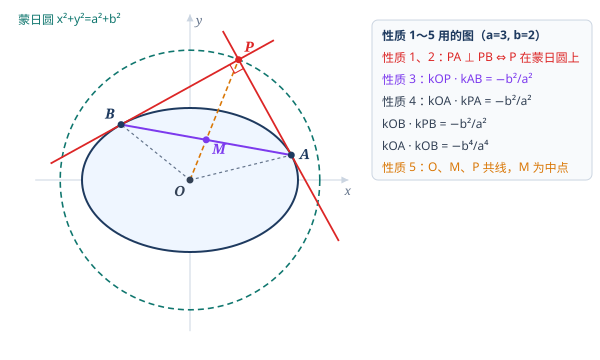

### 性质 1　两条互相垂直的切线的交点 $P$ 的轨迹是蒙日圆 $x^2 + y^2 = a^2 + b^2$

完整证明见上面第二部分第 1 小节：分「斜率不存在」和「斜率存在」两种情况，斜率存在时把切线设成 $y = kx + m$（$m = y_0 - kx_0$）与椭圆联立，由 $\Delta = 0$ 得 $a^2 k^2 + b^2 - m^2 = 0$，整理成关于 $k$ 的方程

$$(a^2 - x_0^2)k^2 + 2x_0 y_0 k + (b^2 - y_0^2) = 0$$

两条切线的斜率 $k_1$、$k_2$ 是它的两个根，再由 $k_1 k_2 = -1$ 和韦达定理得 $x_0^2 + y_0^2 = a^2 + b^2$。

**补充：$\Delta$ 的公式**。直线 $y = kx + m$ 与椭圆 $\frac{x^2}{a^2} + \frac{y^2}{b^2} = 1$ 联立，消去 $y$ 得

$$(b^2 + a^2 k^2)x^2 + 2a^2 kmx + a^2 m^2 - a^2 b^2 = 0$$

$$\Delta = 4a^4 k^2 m^2 - 4(b^2 + a^2 k^2)(a^2 m^2 - a^2 b^2) = 4a^2 b^2(a^2 k^2 + b^2 - m^2)$$

（括号里是「$x^2$ 的分母 × $x$ 系数的平方 + $y^2$ 的分母 × $y$ 系数的平方 − 常数项的平方」。）后面算弦长还要用到它。

### 性质 2　（性质 1 的逆命题）过蒙日圆上任一点 $P$ 作椭圆的两条切线 $PA$、$PB$，则 $PA \perp PB$

**证明**：先说明切线存在。因为 $a > b$，

$$\frac{x_0^2}{a^2} + \frac{y_0^2}{b^2} \ge \frac{x_0^2}{a^2} + \frac{y_0^2}{a^2} = \frac{a^2 + b^2}{a^2} > 1$$

所以 $P$ 在椭圆外，能作两条切线。

- 若有一条切线斜率不存在，则 $x_0 = \pm a$，代入蒙日圆得 $y_0 = \pm b$，另一条切线是 $y = \pm b$，两条切线一竖一横，互相垂直。
- 若两条切线斜率都存在，和性质 1 一样联立、令 $\Delta = 0$，得到同一个方程 $(a^2 - x_0^2)k^2 + 2x_0 y_0 k + (b^2 - y_0^2) = 0$，$k_1$、$k_2$ 是它的两根，由韦达定理

$$k_1 k_2 = \frac{b^2 - y_0^2}{a^2 - x_0^2}$$

这次 $P$ 在蒙日圆上是已知条件，用 $y_0^2 = a^2 + b^2 - x_0^2$ 消去 $y_0$：

$$k_1 k_2 = \frac{b^2 - (a^2 + b^2 - x_0^2)}{a^2 - x_0^2} = \frac{x_0^2 - a^2}{a^2 - x_0^2} = -1$$

所以 $PA \perp PB$。性质 1 和性质 2 互为逆命题：==$PA \perp PB \Leftrightarrow P$ 在蒙日圆上==。

### 性质 3　$k_{OP} \cdot k_{AB} = -\frac{b^2}{a^2}$

**证明**：切点弦 $AB$ 的方程用「半代换」直接写出（见本模块第 4 小节「切线、切点弦与中点弦的统一体系」）：

$$AB:\ \frac{x_0 x}{a^2} + \frac{y_0 y}{b^2} = 1$$

化成斜截式 $y = -\frac{b^2 x_0}{a^2 y_0}x + \frac{b^2}{y_0}$，所以 $k_{AB} = -\frac{b^2 x_0}{a^2 y_0}$。又 $k_{OP} = \frac{y_0}{x_0}$，相乘：

$$k_{OP} \cdot k_{AB} = \frac{y_0}{x_0} \cdot \left(-\frac{b^2 x_0}{a^2 y_0}\right) = -\frac{b^2}{a^2}$$

（$x_0 y_0 \ne 0$ 时斜率都存在；$P$ 在坐标轴上时 $AB$ 与 $OP$ 一横一竖，按垂直理解。）

**记法**：和中点弦结论 $k_{OM} \cdot k_{AB} = -\frac{b^2}{a^2}$ 长得一样，下面性质 5 会说明 $OP$ 正好经过 $AB$ 的中点。

### 性质 4　$k_{PA} \cdot k_{OA} = -\frac{b^2}{a^2}$，$k_{PB} \cdot k_{OB} = -\frac{b^2}{a^2}$，$k_{OA} \cdot k_{OB} = -\frac{b^4}{a^4}$

**证明**：设 $A(x_1, y_1)$，过切点 $A$ 的切线用半代换写出：

$$PA:\ \frac{x_1 x}{a^2} + \frac{y_1 y}{b^2} = 1 \;\Rightarrow\; k_{PA} = -\frac{b^2 x_1}{a^2 y_1}$$

又 $k_{OA} = \frac{y_1}{x_1}$，所以

$$k_{PA} \cdot k_{OA} = -\frac{b^2 x_1}{a^2 y_1} \cdot \frac{y_1}{x_1} = -\frac{b^2}{a^2}$$

同理 $k_{PB} \cdot k_{OB} = -\frac{b^2}{a^2}$。把这两个式子相乘：

$$k_{OA} \cdot k_{OB} \cdot k_{PA} \cdot k_{PB} = \frac{b^4}{a^4}$$

因为 $PA \perp PB$，$k_{PA} \cdot k_{PB} = -1$，所以 ==$k_{OA} \cdot k_{OB} = -\frac{b^4}{a^4}$==。

**理解**：$k_{PA} \cdot k_{OA} = -\frac{b^2}{a^2}$ 可以看成中点弦结论的极限情况。割线 $AB'$ 的中点为 $M'$ 时 $k_{OM'} \cdot k_{AB'} = -\frac{b^2}{a^2}$；让 $B'$ 无限靠近 $A$，割线变成切线，中点 $M'$ 也趋于 $A$，就得到「切线斜率 × 切点与中心连线斜率 $= -\frac{b^2}{a^2}$」。用仿射变换看，就是圆里「切线垂直于半径」（斜率积为 $-1$）。

### 性质 5　$PO$ 平分切点弦 $AB$

即设 $OP$ 与 $AB$ 交于 $M$，则 $M$ 是 $AB$ 的中点。

**证明**：换个说法：设 $M$ 为 $AB$ 的中点，证明 $O$、$M$、$P$ 三点共线。

① 点差法求 $k_{OM} \cdot k_{AB}$。设 $A(x_1, y_1)$、$B(x_2, y_2)$，$M\left(\frac{x_1 + x_2}{2}, \frac{y_1 + y_2}{2}\right)$。两点都在椭圆上：

$$\frac{x_1^2}{a^2} + \frac{y_1^2}{b^2} = 1, \qquad \frac{x_2^2}{a^2} + \frac{y_2^2}{b^2} = 1$$

两式相减：

$$\frac{(x_1 + x_2)(x_1 - x_2)}{a^2} + \frac{(y_1 + y_2)(y_1 - y_2)}{b^2} = 0$$

两边同除以 $(x_1 + x_2)(x_1 - x_2)$，整理得

$$\frac{y_1 + y_2}{x_1 + x_2} \cdot \frac{y_1 - y_2}{x_1 - x_2} = -\frac{b^2}{a^2}, \quad \text{即}\quad k_{OM} \cdot k_{AB} = -\frac{b^2}{a^2}$$

② 由性质 3，$k_{OP} \cdot k_{AB} = -\frac{b^2}{a^2}$。

③ 比较 ①②，$k_{OM} = k_{OP}$，而 $OM$、$OP$ 有公共点 $O$，所以 ==$O$、$M$、$P$ 三点共线==，即 $OP$ 经过 $AB$ 的中点，$PO$ 平分 $AB$。

（$P$ 在坐标轴上时由对称性直接成立。）

### 性质 6　延长 $PA$、$PB$ 交蒙日圆于 $C$、$D$，则 $CD \parallel AB$

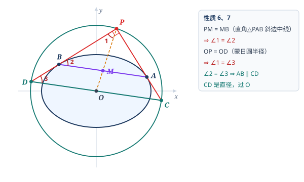

**证明**（几何法）：

① $C$、$O$、$D$ 三点共线。因为 $PC \perp PD$，即 $\angle CPD = 90^\circ$，而 $P$、$C$、$D$ 都在蒙日圆上，直角所对的弦是直径，所以 $CD$ 是蒙日圆的直径，经过圆心 $O$。

② 设 $M$ 为 $AB$ 中点，由性质 5，$M$ 在 $OP$ 上。在 $\text{Rt}\triangle APB$ 中，$PM$ 是斜边 $AB$ 上的中线，所以 $|PM| = |MA| = |MB|$。$\triangle MPB$ 是等腰三角形，记 $\angle 1 = \angle MPB$（即 $\angle OPD$），$\angle 2 = \angle MBP$（即 $\angle ABP$），则 ==$\angle 1 = \angle 2$==。

③ $O$ 是圆心，$|OP| = |OD|$（都是蒙日圆半径）。$\triangle OPD$ 是等腰三角形，记 $\angle 3 = \angle ODP$（即 $\angle CDP$），则 ==$\angle 1 = \angle 3$==。

④ 由 ②③，$\angle 2 = \angle 3$，即 $\angle ABP = \angle CDP$。这是直线 $AB$、$CD$ 被直线 $PD$ 所截得的同位角，所以 ==$CD \parallel AB$==。

### 性质 7　$k_{OP} \cdot k_{CD} = -\frac{b^2}{a^2}$

**证明**：由性质 6，$CD \parallel AB$，所以 $k_{CD} = k_{AB}$。再由性质 3，$k_{OP} \cdot k_{CD} = k_{OP} \cdot k_{AB} = -\frac{b^2}{a^2}$。

### 性质 8　$\triangle AOB$ 面积的最大值为 $\frac{ab}{2}$，最小值为 $\frac{a^2 b^2}{a^2 + b^2}$

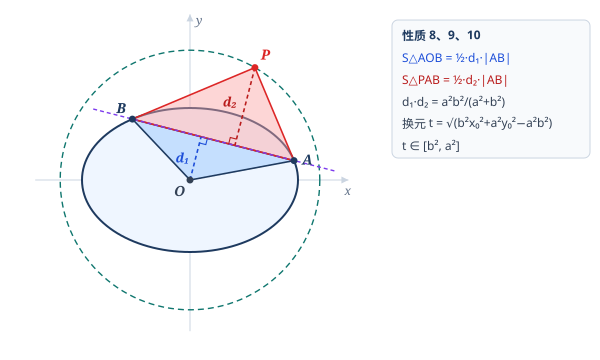

**思路**：以 $AB$ 为底，原点 $O$ 到 $AB$ 的距离 $d_1$ 为高，$S_{\triangle AOB} = \frac{1}{2} d_1 \cdot |AB|$。

**第 1 步：写出 $AB$ 的斜率和截距**。设 $y_0 \ne 0$，由性质 3 的切点弦方程，

$$AB:\ y = kx + m, \qquad k = -\frac{b^2 x_0}{a^2 y_0}, \qquad m = \frac{b^2}{y_0}$$

**第 2 步：求 $|AB|$**。弦长公式 $|AB| = \sqrt{1 + k^2} \cdot \frac{\sqrt{\Delta}}{|b^2 + a^2 k^2|}$，其中 $\Delta = 4a^2 b^2(a^2 k^2 + b^2 - m^2)$（性质 1 的补充）。$\sqrt{1 + k^2}$ 先不展开，因为后面算距离时还会出现，可以约掉。

先算 $a^2 k^2 + b^2$：

$$a^2 k^2 + b^2 = \frac{b^4 x_0^2}{a^2 y_0^2} + b^2 = \frac{b^2(b^2 x_0^2 + a^2 y_0^2)}{a^2 y_0^2}$$

再算 $a^2 k^2 + b^2 - m^2$：

$$a^2 k^2 + b^2 - m^2 = \frac{b^2(b^2 x_0^2 + a^2 y_0^2)}{a^2 y_0^2} - \frac{b^4}{y_0^2} = \frac{b^2(b^2 x_0^2 + a^2 y_0^2 - a^2 b^2)}{a^2 y_0^2}$$

为了书写方便，记

$$t = \sqrt{b^2 x_0^2 + a^2 y_0^2 - a^2 b^2}$$

（$P$ 在椭圆外，根号里为正。）于是

$$\sqrt{\Delta} = 2ab \cdot \frac{b t}{a|y_0|} = \frac{2b^2 t}{|y_0|}$$

$$|AB| = \sqrt{1 + k^2} \cdot \frac{2b^2 t}{|y_0|} \cdot \frac{a^2 y_0^2}{b^2(b^2 x_0^2 + a^2 y_0^2)} = \sqrt{1 + k^2} \cdot \frac{2a^2 |y_0|  t}{b^2 x_0^2 + a^2 y_0^2}$$

**第 3 步：求 $d_1$**。原点到直线 $y = kx + m$ 的距离

$$d_1 = \frac{|m|}{\sqrt{1 + k^2}} = \frac{b^2}{|y_0|\sqrt{1 + k^2}}$$

**第 4 步：算面积**。

$$S_{\triangle AOB} = \frac{1}{2} \cdot \frac{b^2}{|y_0|\sqrt{1 + k^2}} \cdot \sqrt{1 + k^2} \cdot \frac{2a^2 |y_0|  t}{b^2 x_0^2 + a^2 y_0^2} = \frac{a^2 b^2  t}{b^2 x_0^2 + a^2 y_0^2}$$

注意分母 $b^2 x_0^2 + a^2 y_0^2 = t^2 + a^2 b^2$，所以

$$S_{\triangle AOB} = \frac{a^2 b^2  t}{t^2 + a^2 b^2}$$

**第 5 步：求 $t$ 的范围**（换元要换范围）。用 $P$ 在蒙日圆上消去 $x_0$：$x_0^2 = a^2 + b^2 - y_0^2$，

$$t^2 = b^2(a^2 + b^2 - y_0^2) + a^2 y_0^2 - a^2 b^2 = (a^2 - b^2)y_0^2 + b^4$$

$y_0^2 \in [0,\ a^2 + b^2]$：$y_0 = 0$ 时 $t^2 = b^4$；$y_0^2 = a^2 + b^2$ 时 $t^2 = (a^2 - b^2)(a^2 + b^2) + b^4 = a^4$。所以 ==$t \in [b^2,\ a^2]$==。

**第 6 步：求最值**。

$$S_{\triangle AOB} = \frac{a^2 b^2}{t + \frac{a^2 b^2}{t}}$$

分母 $t + \frac{a^2 b^2}{t}$ 是对勾函数，在 $t = ab$ 处取最小值 $2ab$，而 $ab \in [b^2, a^2]$；在区间两端，$t = b^2$ 与 $t = a^2$ 时都等于 $a^2 + b^2$，是最大值。所以

- $t = ab$ 时 $S_{\triangle AOB}$ 最大，为 $\frac{a^2 b^2}{2ab}$ = ==$\frac{ab}{2}$==。此时 $(a^2 - b^2)y_0^2 + b^4 = a^2 b^2$，$y_0^2 = b^2$，$x_0^2 = a^2$，即 $P(\pm a, \pm b)$，两条切线一横一竖（有一条斜率不存在），$\triangle AOB$ 是两直角边为 $a$、$b$ 的直角三角形。
- $t = b^2$ 或 $t = a^2$ 时 $S_{\triangle AOB}$ 最小，为 $\frac{a^2 b^2}{a^2 + b^2}$。此时 $y_0 = 0$ 或 $x_0 = 0$，即 ==$P$ 在坐标轴上==。

（$y_0 = 0$ 时 $AB$ 竖直，上面设斜截式不成立，可直接算：$AB$：$x = \frac{a^2}{x_0}$，$|AB| = \frac{2b^2}{\sqrt{a^2 + b^2}}$，$S = \frac{1}{2} \cdot \frac{a^2}{\sqrt{a^2 + b^2}} \cdot \frac{2b^2}{\sqrt{a^2 + b^2}} = \frac{a^2 b^2}{a^2 + b^2}$，与 $t = b^2$ 的结果一致。）

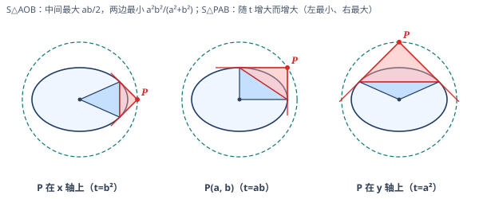

**考场速算**：特殊位置只有两种，「$P$ 在坐标轴上」和「$P(\pm a, \pm b)$，切线一横一竖」，分别代进去比较即可。

### 性质 9　$\triangle PAB$ 面积的最大值为 $\frac{a^4}{a^2 + b^2}$，最小值为 $\frac{b^4}{a^2 + b^2}$

**证明**：仍以 $AB$ 为底，$P$ 到 $AB$ 的距离 $d_2$ 为高。$|AB|$ 在性质 8 已求出。把 $P(x_0, y_0)$ 代入 $AB$：$kx - y + m = 0$：

$$d_2 = \frac{|kx_0 - y_0 + m|}{\sqrt{1 + k^2}} = \frac{\left|-\frac{b^2 x_0^2}{a^2 y_0} - y_0 + \frac{b^2}{y_0}\right|}{\sqrt{1 + k^2}}$$

分子通分（提出负号）：

$$\left|-\frac{b^2 x_0^2 + a^2 y_0^2 - a^2 b^2}{a^2 y_0}\right| = \frac{t^2}{a^2 |y_0|}$$

所以 $d_2 = \frac{t^2}{a^2 |y_0| \sqrt{1 + k^2}}$。于是

$$S_{\triangle PAB} = \frac{1}{2} \cdot \frac{t^2}{a^2 |y_0| \sqrt{1 + k^2}} \cdot \sqrt{1 + k^2} \cdot \frac{2a^2 |y_0|  t}{t^2 + a^2 b^2} = \frac{t^3}{t^2 + a^2 b^2} = \frac{1}{\frac{1}{t} + \frac{a^2 b^2}{t^3}}$$

分母 $\frac{1}{t} + \frac{a^2 b^2}{t^3}$ 在 $t > 0$ 时单调递减，所以 ==$S_{\triangle PAB}$ 随 $t$ 增大而增大==，$t \in [b^2, a^2]$：

- $t = b^2$（$y_0 = 0$，==$P$ 在 $x$ 轴上==）时最小：$\frac{b^6}{b^4 + a^2 b^2} = \frac{b^4}{a^2 + b^2}$；
- $t = a^2$（$x_0 = 0$，==$P$ 在 $y$ 轴上==）时最大：$\frac{a^6}{a^4 + a^2 b^2} = \frac{a^4}{a^2 + b^2}$。

### 性质 10　$O$、$P$ 到 $AB$ 的距离 $d_1$、$d_2$ 之积为定值 $\frac{a^2 b^2}{a^2 + b^2}$

**证明**：由性质 8、9，

$$d_1 d_2 = \frac{b^2}{|y_0|\sqrt{1 + k^2}} \cdot \frac{t^2}{a^2 |y_0| \sqrt{1 + k^2}} = \frac{b^2 t^2}{a^2 y_0^2 (1 + k^2)}$$

而 $1 + k^2 = 1 + \frac{b^4 x_0^2}{a^4 y_0^2} = \frac{a^4 y_0^2 + b^4 x_0^2}{a^4 y_0^2}$，代入：

$$d_1 d_2 = \frac{a^2 b^2 t^2}{a^4 y_0^2 + b^4 x_0^2}$$

分母用 $x_0^2 = a^2 + b^2 - y_0^2$ 消去 $x_0$：

$$a^4 y_0^2 + b^4(a^2 + b^2 - y_0^2) = (a^4 - b^4)y_0^2 + b^4(a^2 + b^2) = (a^2 + b^2)\left[(a^2 - b^2)y_0^2 + b^4\right] = (a^2 + b^2)t^2$$

所以

$$d_1 d_2 = \frac{a^2 b^2 t^2}{(a^2 + b^2)t^2} = \frac{a^2 b^2}{a^2 + b^2}$$

只和 $a$、$b$ 有关。这个定值恰好等于下面第五部分「内准圆」半径的平方。

### 性质 11　椭圆外切矩形面积的取值范围为 $[4ab,\ 2(a^2 + b^2)]$

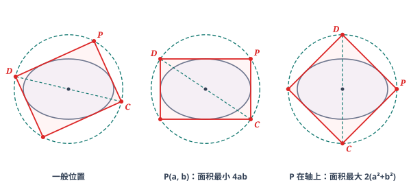

**为什么外切矩形的顶点都在蒙日圆上**：矩形每个顶点处的两条边都是椭圆的切线且互相垂直，由性质 1，顶点在蒙日圆上。以 $P$ 为一个顶点，它的两条边在 $PA$、$PB$ 上，相邻两个顶点就是 $PA$、$PB$ 与蒙日圆的另一个交点 $C$、$D$。$CD$ 是直径（性质 6 ①），矩形被 $CD$ 分成两个全等三角形，所以

$$S_{\text{矩形}} = 2S_{\triangle PCD}$$

**用相似转化成 $\triangle PAB$**：由性质 6，$CD \parallel AB$，所以 $\triangle PCD \sim \triangle PAB$。$O$ 在 $CD$ 上，且 $O$、$P$ 在直线 $AB$ 两侧（$P$ 在椭圆外，$O$ 在椭圆内），所以 $P$ 到 $CD$ 的距离是 $d_1 + d_2$，$P$ 到 $AB$ 的距离是 $d_2$。面积比等于相似比的平方：

$$\frac{S_{\triangle PCD}}{S_{\triangle PAB}} = \left(\frac{d_1 + d_2}{d_2}\right)^2$$

由性质 8、9，$d_1$、$d_2$ 的分母相同，比值只看分子：

$$\frac{d_1 + d_2}{d_2} = \frac{\frac{b^2}{|y_0|} + \frac{t^2}{a^2 |y_0|}}{\frac{t^2}{a^2 |y_0|}} = \frac{a^2 b^2 + t^2}{t^2}$$

再代入 $S_{\triangle PAB} = \frac{t^3}{t^2 + a^2 b^2}$：

$$S_{\text{矩形}} = 2 \cdot \left(\frac{t^2 + a^2 b^2}{t^2}\right)^2 \cdot \frac{t^3}{t^2 + a^2 b^2} = \frac{2(t^2 + a^2 b^2)}{t} = 2\left(t + \frac{a^2 b^2}{t}\right)$$

$t \in [b^2, a^2]$，与性质 8 同一个对勾函数：

- $t = ab$ 时最小：$2 \cdot 2ab$ = ==$4ab$==。此时 $P(\pm a, \pm b)$，矩形就是边长 $2a$、$2b$ 的「正放」矩形。
- $t = b^2$ 或 $a^2$ 时最大：$2(a^2 + b^2)$。此时 $P$ 在坐标轴上，矩形是对角线为蒙日圆直径 $2\sqrt{a^2 + b^2}$ 的正方形，面积 $\frac{1}{2}(2\sqrt{a^2 + b^2})^2 = 2(a^2 + b^2)$。

### 性质 12　切点弦 $AB$ 中点 $E$ 的轨迹方程为 $(a^2 + b^2)\left(\frac{x^2}{a^2} + \frac{y^2}{b^2}\right)^2 = x^2 + y^2$

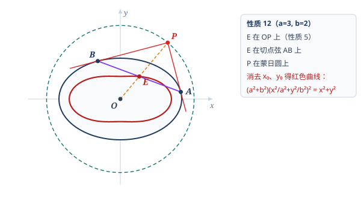

**说明**：视频讲义上把这个方程印成了 $x^2 + y^2 = \left(\frac{1}{a^2} + \frac{1}{b^2}\right)(b^2 x^2 + a^2 y^2)^2$，两边次数对不上，是笔误；板书推导的结果是上面这个。展开后也可以写成 $x^2 + y^2 = \frac{a^2 + b^2}{a^4 b^4}(b^2 x^2 + a^2 y^2)^2$。

**证明**：求谁设谁，设 $E(x, y)$，目标是消去 $x_0$、$y_0$。三个条件：

$$\begin{cases} k_{OE} \cdot k_{AB} = -\frac{b^2}{a^2} \quad \text{（点差法，E 是弦 AB 的中点）} \\ \frac{x_0 x}{a^2} + \frac{y_0 y}{b^2} = 1 \quad \text{（E 在切点弦 AB 上）} \\ x_0^2 + y_0^2 = a^2 + b^2 \quad \text{（P 在蒙日圆上）} \end{cases}$$

① 第一个式子里 $k_{AB} = -\frac{b^2 x_0}{a^2 y_0}$，$k_{OE} = \frac{y}{x}$：

$$\frac{y}{x} \cdot \left(-\frac{b^2 x_0}{a^2 y_0}\right) = -\frac{b^2}{a^2} \;\Rightarrow\; \frac{y x_0}{x y_0} = 1 \;\Rightarrow\; x_0 = \frac{x y_0}{y}$$

（这就是性质 5：$E$ 在 $OP$ 上。）

② 代入第三个式子：

$$\frac{x^2 y_0^2}{y^2} + y_0^2 = a^2 + b^2 \;\Rightarrow\; y_0^2 = \frac{(a^2 + b^2)y^2}{x^2 + y^2}, \qquad x_0^2 = \frac{x^2}{y^2} y_0^2 = \frac{(a^2 + b^2)x^2}{x^2 + y^2}$$

因为 $E$、$P$ 在 $O$ 的同侧，$x_0$ 与 $x$ 同号、$y_0$ 与 $y$ 同号，开方得

$$x_0 = \frac{\sqrt{a^2 + b^2}}{\sqrt{x^2 + y^2}}  x, \qquad y_0 = \frac{\sqrt{a^2 + b^2}}{\sqrt{x^2 + y^2}}  y$$

③ 代入第二个式子：

$$\frac{\sqrt{a^2 + b^2}}{\sqrt{x^2 + y^2}} \left(\frac{x^2}{a^2} + \frac{y^2}{b^2}\right) = 1 \;\Rightarrow\; \sqrt{a^2 + b^2}\left(\frac{x^2}{a^2} + \frac{y^2}{b^2}\right) = \sqrt{x^2 + y^2}$$

两边平方，得

$$(a^2 + b^2)\left(\frac{x^2}{a^2} + \frac{y^2}{b^2}\right)^2 = x^2 + y^2$$

不用死记，记住「点差法 + $E$ 在 $AB$ 上 + $P$ 在蒙日圆上，三个式子消去 $x_0$、$y_0$」这个流程即可。

## 四、双曲线、抛物线蒙日圆的记法与另一种证法

### 1. 双曲线：把 $b^2$ 换成 $-b^2$

双曲线 $\frac{x^2}{a^2} - \frac{y^2}{b^2} = 1$ 可以写成 $\frac{x^2}{a^2} + \frac{y^2}{-b^2} = 1$，和椭圆形式一样，只是第二个分母是 $-b^2$。椭圆的蒙日圆是「两个分母相加」$x^2 + y^2 = a^2 + b^2$，于是双曲线的蒙日圆就是 $x^2 + y^2 = a^2 + (-b^2)$，即 ==$x^2 + y^2 = a^2 - b^2$==，并且==只有 $a > b$ 时才存在==。

$\Delta$ 公式也照样用：联立 $y = kx + m$，$\Delta = 4a^2(-b^2)\left[a^2 k^2 + (-b^2) - m^2\right]$，令 $\Delta = 0$ 得 $a^2 k^2 - b^2 - m^2 = 0$，把 $m = y_0 - kx_0$ 代入并整理成关于 $k$ 的方程

$$(a^2 - x_0^2)k^2 + 2x_0 y_0 k - b^2 - y_0^2 = 0$$

由 $k_1 k_2 = -1$ 和韦达定理，$\frac{-b^2 - y_0^2}{a^2 - x_0^2} = -1$，即 $x_0^2 + y_0^2 = a^2 - b^2$。

### 2. 抛物线：设切点的证法（准线可以看成半径无穷大的圆）

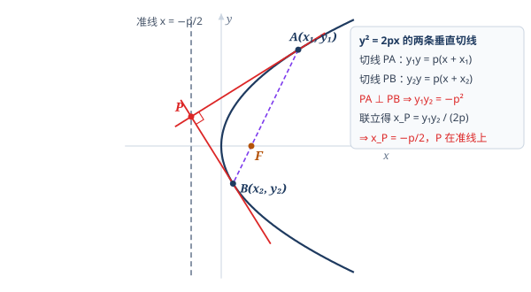

上面第二部分第 4 小节是设切线斜率的证法，下面是设切点的证法，也是阿基米德三角形里的结论。

**证明**：抛物线 $y^2 = 2px$（$p > 0$），设切点 $A(x_1, y_1)$、$B(x_2, y_2)$。

① 写切线。半代换：$y^2$ 换成 $y_1 y$，$2x$ 拆成 $x + x$ 后换成 $x_1 + x$，

$$PA:\ y_1 y = p(x + x_1), \qquad PB:\ y_2 y = p(x + x_2)$$

所以 $k_{PA} = \frac{p}{y_1}$，$k_{PB} = \frac{p}{y_2}$。

② 用垂直条件：$k_{PA} \cdot k_{PB} = \frac{p}{y_1} \cdot \frac{p}{y_2} = -1$，得 ==$y_1 y_2 = -p^2$==。

③ 求交点横坐标。两条切线写成斜截式

$$y = \frac{p}{y_1}x + \frac{p x_1}{y_1}, \qquad y = \frac{p}{y_2}x + \frac{p x_2}{y_2}$$

令两式相等：

$$\left(\frac{p}{y_1} - \frac{p}{y_2}\right)x = \frac{p x_2}{y_2} - \frac{p x_1}{y_1} \;\Rightarrow\; \frac{p(y_2 - y_1)}{y_1 y_2}  x = \frac{p(x_2 y_1 - x_1 y_2)}{y_1 y_2}$$

$$\Rightarrow\; x_P = \frac{x_2 y_1 - x_1 y_2}{y_2 - y_1}$$

④ 用 $x_1 = \frac{y_1^2}{2p}$、$x_2 = \frac{y_2^2}{2p}$ 换掉 $x$：

$$x_P = \frac{\frac{y_2^2 y_1 - y_1^2 y_2}{2p}}{y_2 - y_1} = \frac{y_1 y_2 (y_2 - y_1)}{2p(y_2 - y_1)} = \frac{y_1 y_2}{2p}$$

⑤ 代入 $y_1 y_2 = -p^2$：$x_P = \frac{-p^2}{2p} = -\frac{p}{2}$。所以两条互相垂直的切线的交点 ==$P$ 在准线 $x = -\frac{p}{2}$ 上==。

## 五、椭圆的内准圆（性质 1～4）

**定义**：椭圆 $\frac{x^2}{a^2} + \frac{y^2}{b^2} = 1$（$a > b > 0$）上两点 $A$、$B$ 满足 $OA \perp OB$（$O$ 为椭圆中心），过 $O$ 作 $AB$ 的垂线，垂足为 $H$。$A$、$B$ 运动时，$H$ 的轨迹是一个圆，叫椭圆的==内准圆==：

$$x^2 + y^2 = \frac{a^2 b^2}{a^2 + b^2} = \frac{1}{\frac{1}{a^2} + \frac{1}{b^2}}$$

方程不用死记，由下面的性质 1 推出。

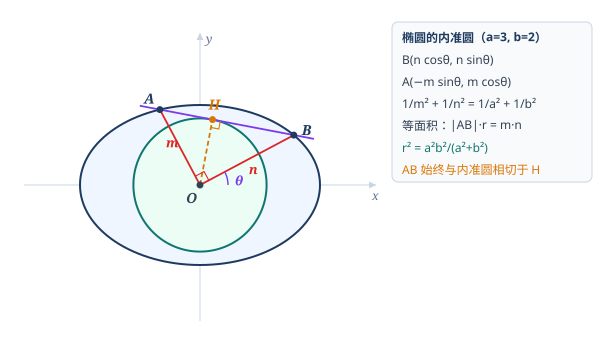

**设法（参数法）**：设 $|OA| = m$，$|OB| = n$，$OB$ 与 $x$ 轴正方向的夹角为 $\theta$，则 $OA$ 的方向角为 $\theta + \frac{\pi}{2}$，

$$B(n \cos \theta,\ n \sin \theta), \qquad A\left(m \cos\left(\theta + \frac{\pi}{2}\right),\ m \sin\left(\theta + \frac{\pi}{2}\right)\right) = (-m \sin \theta,\ m \cos \theta)$$

### 性质 1　$\frac{1}{|OH|^2} = \frac{1}{|OA|^2} + \frac{1}{|OB|^2} = \frac{1}{a^2} + \frac{1}{b^2}$

**证明**：① $A$、$B$ 在椭圆上，代入：

$$\frac{m^2 \sin^2 \theta}{a^2} + \frac{m^2 \cos^2 \theta}{b^2} = 1 \;\Rightarrow\; \frac{1}{m^2} = \frac{\sin^2 \theta}{a^2} + \frac{\cos^2 \theta}{b^2}$$

$$\frac{n^2 \cos^2 \theta}{a^2} + \frac{n^2 \sin^2 \theta}{b^2} = 1 \;\Rightarrow\; \frac{1}{n^2} = \frac{\cos^2 \theta}{a^2} + \frac{\sin^2 \theta}{b^2}$$

两式相加，$\sin^2 \theta + \cos^2 \theta = 1$：

$$\frac{1}{|OA|^2} + \frac{1}{|OB|^2} = \frac{1}{m^2} + \frac{1}{n^2} = \frac{1}{a^2} + \frac{1}{b^2}$$

② 等面积法求 $r = |OH|$。$\text{Rt}\triangle AOB$ 的面积有两种算法：$\frac{1}{2}|AB| \cdot r = \frac{1}{2} mn$，所以 $r = \frac{mn}{|AB|}$。平方，并用勾股定理 $|AB|^2 = m^2 + n^2$：

$$r^2 = \frac{m^2 n^2}{m^2 + n^2} \;\Rightarrow\; \frac{1}{r^2} = \frac{m^2 + n^2}{m^2 n^2} = \frac{1}{m^2} + \frac{1}{n^2}$$

③ 由 ①②，

$$\frac{1}{|OH|^2} = \frac{1}{r^2} = \frac{1}{a^2} + \frac{1}{b^2} = \frac{a^2 + b^2}{a^2 b^2} \;\Rightarrow\; r^2 = \frac{a^2 b^2}{a^2 + b^2}$$

$|OH|$ 是定值，所以 $H$ 在以 $O$ 为圆心、$r$ 为半径的圆上，这就是内准圆的方程。又因为 $OH \perp AB$，所以==直线 $AB$ 始终与内准圆相切，切点是 $H$==。

### 性质 2　弦长 $|AB|$ 的取值范围为 $\left[\frac{2ab}{\sqrt{a^2 + b^2}},\ \sqrt{a^2 + b^2}\right]$

**证明**（乘 1 法）：$|AB|^2 = m^2 + n^2$。由性质 1，$r^2\left(\frac{1}{m^2} + \frac{1}{n^2}\right) = 1$，乘上去不改变大小：

$$|AB|^2 = (m^2 + n^2)\left(\frac{1}{m^2} + \frac{1}{n^2}\right) \cdot r^2 = \left(1 + \frac{m^2}{n^2} + \frac{n^2}{m^2} + 1\right) \cdot \frac{a^2 b^2}{a^2 + b^2}$$

令 $t = \frac{m^2}{n^2} = \frac{|OA|^2}{|OB|^2}$，则 $|AB|^2 = \left(2 + t + \frac{1}{t}\right) \cdot \frac{a^2 b^2}{a^2 + b^2}$。

**求 $t$ 的范围**：$|OA|$、$|OB|$ 都在 $[b, a]$ 内。$t$ 最小时 $|OA|$ 最短、$|OB|$ 最长：$A$ 在短轴端点、$B$ 在长轴端点（此时正好 $OA \perp OB$），$t = \frac{b^2}{a^2}$；反过来 $t$ 最大为 $\frac{a^2}{b^2}$。所以 $t \in \left[\frac{b^2}{a^2}, \frac{a^2}{b^2}\right]$，区间包含 $1$。

$t + \frac{1}{t}$ 是对勾函数，拐点在 $t = 1$：

- $t = 1$，即 ==$|OA| = |OB|$== 时最小：$|AB|^2 = 4 \cdot \frac{a^2 b^2}{a^2 + b^2}$，$|AB|_{\min} = \frac{2ab}{\sqrt{a^2 + b^2}}$。
- $t = \frac{b^2}{a^2}$ 或 $\frac{a^2}{b^2}$，即 ==$A$、$B$ 在坐标轴上==时最大：

$$|AB|^2 = \left(2 + \frac{a^2}{b^2} + \frac{b^2}{a^2}\right) \cdot \frac{a^2 b^2}{a^2 + b^2} = \frac{(a^2 + b^2)^2}{a^2 b^2} \cdot \frac{a^2 b^2}{a^2 + b^2} = a^2 + b^2$$

$|AB|_{\max} = \sqrt{a^2 + b^2}$。

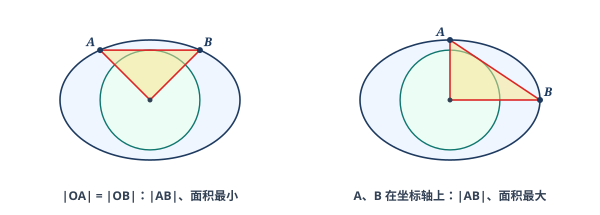

### 性质 3　$\frac{a^2 b^2}{a^2 + b^2} \le S_{\triangle AOB} \le \frac{ab}{2}$

**证明**：$S_{\triangle AOB} = \frac{1}{2}|AB| \cdot r$，$r = \frac{ab}{\sqrt{a^2 + b^2}}$ 是定值，所以面积和 $|AB|$ 同时取最值：

$$S_{\min} = \frac{1}{2} \cdot \frac{2ab}{\sqrt{a^2 + b^2}} \cdot \frac{ab}{\sqrt{a^2 + b^2}} = \frac{a^2 b^2}{a^2 + b^2}\quad(|OA| = |OB| \text{ 时})$$

$$S_{\max} = \frac{1}{2} \cdot \sqrt{a^2 + b^2} \cdot \frac{ab}{\sqrt{a^2 + b^2}} = \frac{ab}{2}\quad(A, B \text{ 在坐标轴上时})$$

（与蒙日圆性质 8 的范围相同。）

### 性质 4　椭圆的内准圆内切于以四个顶点为顶点的菱形

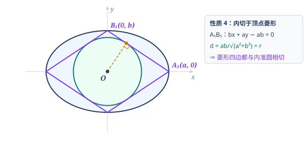

**证明**：设 $A_1(a, 0)$、$B_1(0, b)$，由截距式，直线 $A_1 B_1$：$\frac{x}{a} + \frac{y}{b} = 1$，即 $bx + ay - ab = 0$。圆心 $O$ 到它的距离

$$d = \frac{|-ab|}{\sqrt{a^2 + b^2}} = \frac{ab}{\sqrt{a^2 + b^2}}$$

而 $r^2 = \frac{a^2 b^2}{a^2 + b^2}$，即 $r = \frac{ab}{\sqrt{a^2 + b^2}} = d$，所以直线 $A_1 B_1$ 与内准圆相切。由对称性，菱形四条边都与内准圆相切。

## 六、双曲线的内准圆（性质 1～3）

**定义**：双曲线 $\frac{x^2}{a^2} - \frac{y^2}{b^2} = 1$ 上两点 $A$、$B$ 满足 $OA \perp OB$，过 $O$ 作 $AB$ 的垂线，垂足为 $H$，$H$ 的轨迹叫双曲线的内准圆：

$$x^2 + y^2 = \frac{a^2 b^2}{b^2 - a^2}$$

**存在条件：==$b > a > 0$==**。双曲线无限接近渐近线，过原点的直线只有夹在两条渐近线之间（含实轴的那一侧）才与双曲线相交。$b > a$ 时 $\frac{b}{a} > 1$，两条渐近线所成的含实轴的角大于 $\frac{\pi}{2}$，才放得下两条互相垂直的、都与双曲线相交的直线；若这个角不大于 $\frac{\pi}{2}$，互相垂直的两条直线 $OA$、$OB$ 不能同时与双曲线相交。

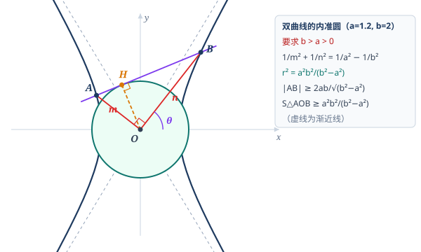

设法同椭圆：$A(m \cos \theta,\ m \sin \theta)$，$B(-n \sin \theta,\ n \cos \theta)$。

### 性质 1　$\frac{1}{|OH|^2} = \frac{1}{|OA|^2} + \frac{1}{|OB|^2} = \frac{1}{a^2} - \frac{1}{b^2}$

**证明**：$A$、$B$ 代入双曲线：

$$\frac{m^2 \cos^2 \theta}{a^2} - \frac{m^2 \sin^2 \theta}{b^2} = 1 \;\Rightarrow\; \frac{1}{m^2} = \frac{\cos^2 \theta}{a^2} - \frac{\sin^2 \theta}{b^2}$$

$$\frac{n^2 \sin^2 \theta}{a^2} - \frac{n^2 \cos^2 \theta}{b^2} = 1 \;\Rightarrow\; \frac{1}{n^2} = \frac{\sin^2 \theta}{a^2} - \frac{\cos^2 \theta}{b^2}$$

相加得 $\frac{1}{m^2} + \frac{1}{n^2} = \frac{1}{a^2} - \frac{1}{b^2}$。等面积法与椭圆完全相同，$\frac{1}{r^2} = \frac{1}{m^2} + \frac{1}{n^2}$，所以

$$\frac{1}{r^2} = \frac{1}{a^2} - \frac{1}{b^2} = \frac{b^2 - a^2}{a^2 b^2} \;\Rightarrow\; r^2 = \frac{a^2 b^2}{b^2 - a^2}$$

这也说明了为什么要 $b > a$：右边必须为正。

### 性质 2　$|AB| \ge \frac{2ab}{\sqrt{b^2 - a^2}}$

**证明**：同样用乘 1 法，

$$|AB|^2 = (m^2 + n^2)\left(\frac{1}{m^2} + \frac{1}{n^2}\right) r^2 = \left(2 + t + \frac{1}{t}\right) \cdot \frac{a^2 b^2}{b^2 - a^2}, \qquad t = \frac{m^2}{n^2}$$

和椭圆不同的是，$|OA|$ 可以无限长（$OA$ 越靠近渐近线，$|OA|$ 越大），所以 $t \in (0, +\infty)$。由基本不等式 $t + \frac{1}{t} \ge 2$，

$$|AB|^2 \ge \frac{4a^2 b^2}{b^2 - a^2} \;\Rightarrow\; |AB| \ge \frac{2ab}{\sqrt{b^2 - a^2}}$$

当且仅当 $t = 1$，即 ==$|OA| = |OB|$== 时取等号；没有最大值。

### 性质 3　$S_{\triangle AOB} \ge \frac{a^2 b^2}{b^2 - a^2}$

**证明**：$S_{\triangle AOB} = \frac{1}{2}|AB| \cdot r$，$r = \frac{ab}{\sqrt{b^2 - a^2}}$ 是定值，

$$S_{\triangle AOB} \ge \frac{1}{2} \cdot \frac{2ab}{\sqrt{b^2 - a^2}} \cdot \frac{ab}{\sqrt{b^2 - a^2}} = \frac{a^2 b^2}{b^2 - a^2}$$

$|OA| = |OB|$ 时取最小值，没有最大值。

## 七、蒙日圆与内准圆对照

| | 蒙日圆（两切线垂直，交点轨迹） | 内准圆（$OA \perp OB$，垂足 $H$ 的轨迹） |
| --- | --- | --- |
| 椭圆 | $x^2 + y^2 = a^2 + b^2$ | $\frac{1}{r^2} = \frac{1}{a^2} + \frac{1}{b^2}$，即 $x^2 + y^2 = \frac{a^2 b^2}{a^2 + b^2}$ |
| 双曲线 | $x^2 + y^2 = a^2 - b^2$（要求 $a > b$） | $\frac{1}{r^2} = \frac{1}{a^2} - \frac{1}{b^2}$，即 $x^2 + y^2 = \frac{a^2 b^2}{b^2 - a^2}$（要求 $b > a$） |
| 抛物线 | 准线 $x = -\frac{p}{2}$ | — |

**记法**：蒙日圆是「两个分母相加」，内准圆是「两个分母的倒数相加」；双曲线都把 $b^2$ 换成 $-b^2$。
